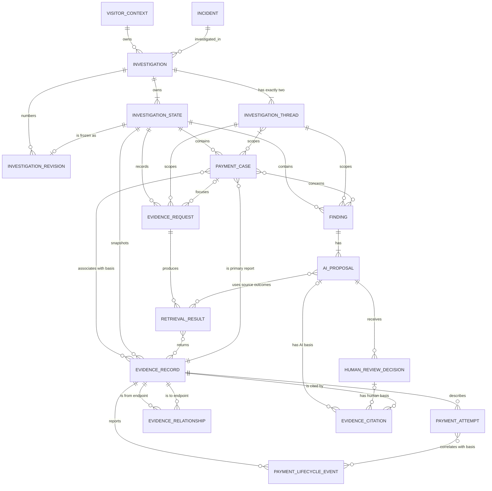
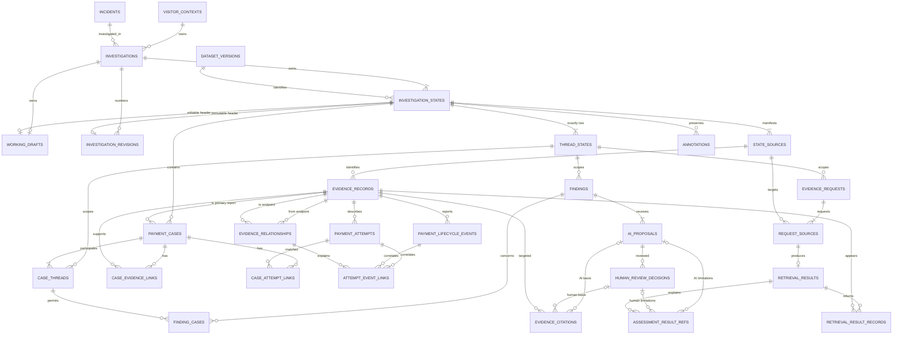

# OpsPilot AI — Conceptual and Logical Domain Model v0.1

**Status:** Approved requirements and first-slice scope are consolidated in the [Decision Log](DECISION_LOG.md), including D-019–D-022. Section 18 finalizes first-slice schema details; later-feature relational mechanisms remain proposals. No application schema or migration is implemented.
**Scope:** Conceptual/logical entities, ERDs, the full 29-table proposal, integrity rules, indexes, and draft/snapshot persistence. Application architecture, technology comparisons, API boundaries, and the approved first-slice contract belong in [System Architecture v0.1](SYSTEM_ARCHITECTURE_V0.1.md). See [Project Status](PROJECT_STATUS.md) for readiness and blockers.

## 1. Purpose and reading guide

A conceptual ERD describes the things the product must remember and how they relate. A logical relational model turns those concepts into tables, keys, and integrity rules. A many-to-many relationship becomes an association table when it needs enforceable references, its own explanation, or provenance.

The central distinction is between **source observations**, **AI interpretation**, and **human review**. A payment case is a concern to investigate, not a payment attempt or a proven financial outcome. A saved revision is a historical snapshot, not an editable workspace.

An investigation is unique per **visitor context and incident** under D-018, with exactly two logical threads per investigation. Several visitors may independently investigate the same synthetic incident. The approved [PRD](PRD_V0.1.md) and [UX Blueprint](UX_BLUEPRINT_V0.1.md), supplemented by the [Decision Log](DECISION_LOG.md), remain authoritative.

The former review labels D1–D13 are historical aliases, not a second decision-ID sequence. Their canonical `D-NNN` mapping is maintained only in the [Decision Log](DECISION_LOG.md). Decision references below use that canonical numbering.

**Save/refresh clarification:** D-009 distinguishes routine durable draft persistence from numbered saves. Explicit Save creates a revision, and D-012 / PRD FR-13 also require a successful intentional full refresh to create a revision. Automatic draft persistence creates neither. This preserves the previously approved interpretation of review D2 and D5.

## 2. Mermaid conceptual ERD

Cardinality notation: `||` = exactly one, `o|` = zero or one, `|{` = one or more, and `o{` = zero or more. Read the symbols at each end as the allowed number of that entity for one entity at the other end.

The diagram covers synthetic incident identities available to OpsPilot and their visitor-owned investigations. An incident or visitor context can have no investigation yet. Each investigation has exactly one incident and one visitor owner; the pair is unique under D-018. Visitor Context is a stable logical owner identity. D-019 now resolves requests through a hashed opaque-cookie credential on that owner header; expiry does not reassign its investigations.

### Constraints beyond the diagram

- Each investigation belongs to exactly one Visitor Context and Incident, with a unique `(visitor_context_id, incident_id)` pair. A visitor owner is not reassigned to move saved history between visitors.
- Every investigation has exactly two stable thread identities: **Payment failures** and **Possible duplicates**, one of each. Mermaid's one-or-more notation cannot enforce exactly two. Both remain present in every state, even when empty; revisions do not create new logical threads.
- An investigation has at most one editable working state and zero or more frozen states. Each frozen state has exactly one numbered revision; a working state has none. Investigation State is a supporting conceptual entity, not a requirement for an additional database table.
- Every revision belongs to the same investigation as its frozen state. Its number is unique within that investigation and increases along one linear history. No branching, merging, or rollback is introduced.
- All cases, evidence, relationships, requests/results, findings, proposals, decisions, citations, and their associations are state-scoped, directly or through their parent. Associations must not accidentally combine different states or incidents. Shared physical storage is possible later, provided it preserves immutable versions.
- Each case belongs to one or both of the investigation's two threads in its state. This permits shared case context without sharing human decisions automatically. Case/thread membership is an explicit association, not inferred from customer identity.
- Each evidence relationship has exactly two record endpoints in the same state. The two edges in the diagram represent different endpoint roles, not four endpoints.
- Each citation belongs to **exactly one** AI proposal **or** human review decision, never both or neither. It targets exactly one inspectable evidence record in the same state. The two optional owner relationships require this additional exclusive-owner rule.
- A finding belongs to one thread and can concern zero, one, or several cases in that thread. Zero cases permits incident/thread-level findings. Cross-thread comparison must be explicit; it does not silently move findings or review decisions between threads.

## 3. Entity responsibilities

| Entity | Responsibility and important information |
|---|---|
| **Visitor Context** | Stable owner boundary for isolated investigations. D-019 uses one server-issued hashed cookie credential plus absolute expiry on this header initially. It is not an enterprise account; no login or account recovery. Ownership survives access expiry, with no reassignment or cascading data deletion. |
| **Incident** | Identifies the synthetic incident: source incident reference, category, severity, service/region, incident time and timezone, and description where supplied. These are source context, not incident decisions made by OpsPilot. Preserve the displayed context within each saved state. |
| **Investigation** | One visitor context's logical investigation of one incident, unique for that pair. Groups its two threads, working state, and numbered history; another visitor's investigation is separate even when the source incident is the same. |
| **Investigation Revision** | A numbered, immutable checkpoint identifying one frozen state, its creation time, and creation reason such as explicit save or complete evidence refresh. No revision number is presented as successfully saved before the snapshot is committed. |
| **Investigation State** | The complete investigation content at a point in time: either editable working content or frozen revision content. Includes incident context, dataset-version reference, evidence content and source-coverage manifest, case/thread membership, summaries, annotations, limitations, unresolved questions, and the review state. This separates ordinary editing from numbered saves. |
| **Investigation Thread** | One stable investigation context: Payment failures or Possible duplicates. Scopes cases, requests, and findings. Its state-specific content is captured in Investigation State; it is not a new incident, revision, or autonomous agent. |
| **Payment Case** | An individual concern under investigation, such as a reported failure or possible duplicate. Keeps case reference, reported issue, available customer/order/payment references, reported amount/currency and report time, with provenance. May exist before any attempt has been matched. Payment outcome and investigation progress are separate. |
| **Payment Attempt** | A typed observation of an internal attempt, grounded in its primary Evidence Record. Keeps the source attempt identity, internal status, amount/currency, customer/order references, and provider/request/idempotency references when present. Repeated mentions of the same attempt are not additional attempts. |
| **Payment Lifecycle Event** | A typed observation of a source-reported payment event, such as authorization, capture, reversal/void, refund, settlement, or issuer/bank posting. Keeps stage, event/object identity, source status, available amount/currency, and event-time precision. A provider request or status observation must not be relabelled as a capture or posting. Unknown stage remains unknown. |
| **Evidence Record** | An inspectable, immutable-within-a-saved-state source record or extract. Preserves source identity, source record reference where available, original useful content, field/identifier provenance, synthetic fixture provenance, dataset version, timestamp roles/timezones/precision, and coverage limitations. Covers alerts, metrics, internal records, tickets/handoffs, provider extracts, logs/traces, and deployment history. |
| **Evidence Relationship** | Explains a directed association between two Evidence Records. Preserves relationship kind, compared field names/values, source-provided reference or lookup record, origin of the association, rationale, limitations, and whether it is direct, contextual, candidate, or unverified. It records correlation, not assumed causation. |
| **Evidence Request** | Records an investigator- or AI-initiated bounded evidence query: thread, optional selected case, approved source scope, identifier/filter/time-window criteria, and request time. It records what OpsPilot requested, not an instruction to execute arbitrary SQL or act on a payment. |
| **Retrieval Result** | Records a source-specific outcome of a request, including zero returned records. Keeps source, execution/outcome time, outcome state, query/coverage scope, completeness, returned-record references, and safe error/limitation details. Results can differ across sources in the same request. |
| **Finding** | A specific claim within one thread and state, with optional links to several cases. Preserves the claim text and logical finding identity so later versions can be understood without overwriting earlier wording. It does not hold a single mixed AI/human status. |
| **AI Proposal** | An AI assessment of the finding as written: proposed Confirmed / Not confirmed / Inconclusive status, rationale, proposal time, citations, relevant retrieval outcomes, and limitations. Multiple proposals preserve reassessments; only one is current for a finding in a state. No proposal is a human decision. |
| **Human Review Decision** | An individual human acceptance or correction of one exact proposal: action, chosen status, decision time, mandatory correction rationale for either thread under D-010, optional acceptance note, and optional reviewer display name. Preserves prior decisions if changed. A display name is not verified identity, and review does not authorize an incident or payment action. |
| **Evidence Citation** | Links an exact proposal or human decision to an inspectable record and relevant fields/locations, classifying the use as supporting, contradicting, or contextual. Separating citations by owner prevents a human correction from rewriting the AI's evidence basis. Human decisions may explicitly retain the proposal's basis or record their own citations. |

The fields above explain meaning, not final column lists. A source record can contain several attempts or lifecycle events. In particular, the supplied provider extract contains both an authorization and a capture: it must not be forced into a one-record/one-event mapping. Other sources may mention the same observation; preserve those corroborating records without double-counting events.

## 4. Key relationships and why they matter

### 4.1 Cases, attempts, lifecycle events, and evidence

Case-to-record association is many-to-many. A complaint can relate to several attempts, and a record can be relevant to more than one case. Preserve association-level basis: direct source reference, documented lookup, field match, or explicitly tentative context, including the source fields and any supporting lookup record. A plain unqualified link is insufficient.

The case-to-attempt relationship is visible through its associated Evidence Records and their typed Payment Attempt observations. It must distinguish candidate matches from established identifier links; the ERD does not force an attempt onto a case with ambiguous identifiers.

Attempt-to-lifecycle-event correlation is also many-to-many and optional on both sides. Two attempts can refer to one provider capture; an event can be observed without a reliable internal-attempt match. Preserve the correlation basis through the corresponding Evidence Relationships and source fields. Do not impose a mandatory `event belongs to exactly one attempt` rule.

Customer/order/amount matches and idempotency-key reuse can be displayed as signals. They do not establish payment identity, deduplication correctness, root cause, or number of bank debits. Temporal proximity is contextual and cannot become an asserted causal or identity link. No settlement, posting, or refund event is created merely to fill a missing lifecycle stage.

### 4.2 Source records versus retrieval outcomes

A request can have no result yet while pending, or multiple source-specific results. For example, internal records may load successfully while provider evidence fails. A completed request must account for every requested source, including an explicit failure rather than silent omission. A retry is another recorded request linked to the earlier request; it does not overwrite the original outcome.

Returned-record membership is many-to-many: one result can return many records and the same record can appear in many results. Preserve any membership-specific match explanation or field selection rather than copying the source record into a different identity on each query.

Keep these separate dimensions:

- **Execution:** pending, completed, failed, or partially completed where applicable.
- **Availability:** represented in the dataset, not included/not constructed, or explicitly known to exist but unavailable.
- **Matches:** records returned or no matching records within the stated query scope.
- **Coverage:** complete only within a stated verified scope, partial, or not independently verified.
- **Interpretation:** ambiguous links or conflicting records/fields; neither is an execution failure.

These are conceptual distinctions, not a final enum design. Missing fields and unavailable timestamps retain their reason in the record/state. A missing source or bank record is not fabricated as an Evidence Record. A proposal can reference a zero-record Retrieval Result and the state's source-coverage limitation to explain an Inconclusive assessment.

Source coverage must exist in the state manifest even when no request has been made. This permits all four Evidence sections to remain visible and accurately distinguish not checked, not included, no matches, and failure. The four UI sections do not exclude incident-level alerts, metrics, or deployment evidence from the domain model.

The historical Support lookup in `SYN-ZD-HANDOFF-001` remains an Evidence Record describing what Support previously searched. It is not falsely recorded as a new request executed by OpsPilot.

### 4.3 Finding, proposal, decision, and citation

The claim and its assessment are different things. For example, the finding “the customer was charged twice” may have an AI-proposed Inconclusive status, followed by a separate human acceptance of that status. Neither the existence of the finding nor its review makes the claim Confirmed.

Each proposal has its own evidence basis. Every factual assertion in its explanation must have inspectable supporting references. A hypothesis or unresolved question may have no supporting record if explicitly labelled unverified; the zero-or-more citation cardinality permits this without allowing unsupported factual conclusions. Missing evidence is a limitation, not a supporting record proving non-occurrence.

Each decision targets the exact proposal, wording, and evidence basis reviewed. Accepting records the proposed status; correcting records the human-selected status and preserves the original proposal. Only one explicit decision is effective for the current proposal in a state; earlier decisions can remain as history. Multiple decisions represent corrections over time, not multiple reviewers or an approval chain.

A replacement AI proposal is unreviewed even when its status happens to match an earlier reviewed proposal. A changed claim needs a new finding version; a stable logical reference can connect the versions without modifying the old text. This is a proposed preservation rule; exact version representation remains open for logical design.

For each case **within its thread and current state**, derive progress from current linked findings and their effective human decisions:

- **Not started:** no current finding has a human decision, including when there are no findings.
- **In progress:** some current findings have a human decision and others do not.
- **Reviewed:** at least one current finding exists and all current findings have a human decision.

Reviewed can coexist with Inconclusive and does not mean resolved. Opening a case is not a review. AI-proposed and human-reviewed status counts must be calculated separately. A shared case must not become Reviewed in one thread merely because different findings were reviewed in the other.

## 5. Save, reopen, and refresh semantics

### Explicit save

1. The investigator works in the editable state. Selecting a case or reviewing one claim does not create a numbered revision.
2. **Save investigation** captures that complete state as a new numbered, immutable revision. Captured content includes evidence, source coverage, case/thread associations, requests/results, findings, proposals, decisions, citations, summaries, annotations, and timestamps.
3. Subsequent edits take place in a working copy, never by updating the frozen state. A revision can contain a mixture of reviewed and unreviewed claims; “saved” and “reviewed” are separate properties.
4. Snapshot creation and revision-number publication must succeed together. On failure, preserve working changes where possible and do not claim a revision was saved. The implementation transaction boundary is for later design.

### Reopen

Opening a selected revision restores its exact evidence and investigation content, dataset-version context, creation time, and saved review state. It performs no source refresh and does not rerun the model to reconstruct old findings. Citations open the saved record version, not a possibly changed current fixture.

Frozen snapshots, including the latest saved revision, stay immutable. Under D-011, only the latest revision may seed a separate working state. An existing persisted draft is restored rather than silently replaced on reload. Viewing an older revision is read-only; replacing a draft requires Save, Discard, or Cancel. Historical editing, branching, merging, and rollback are not added.

### Intentional evidence refresh

A successful refresh loads the **complete current approved synthetic dataset version**, creates a new numbered revision, and preserves the old revision. It is not selective-source refresh, a live query, or an edit to historical records.

In the refreshed state, prior human decisions cannot count as current review, even for apparently unchanged evidence. Old proposals/decisions remain accessible in their old revision. Any regenerated findings/proposals require individual review again. The newly frozen refresh revision records the refreshed, unreviewed state; subsequent human reviews occur in its working copy and a later explicit save records them as another revision. This sequence reconciles refresh-created revisions with immutable snapshots without editing the refresh revision afterward.

Under D-012, failed or incomplete refreshes publish no refresh revision and do not replace the previous state. “Complete dataset” means every record and declared source limitation in the approved fixture manifest loaded successfully, not that the fixture proves complete real-world provider coverage. Ordinary query failures may still be represented honestly as Retrieval Results.

## 6. Important modelling trade-offs

| Choice in this proposal | Alternative | Reasoning and cost |
|---|---|---|
| Persist a separate working draft (D-009) | Browser-only draft or editable latest revision | D-009 settles durability and separation. D-013 settles full relational snapshot copies; detailed tables and write guards remain proposals. |
| Full relational snapshot copies (D-013) | Shared immutable evidence versions, serialized history, or regeneration on reopen | Owner-approved initial strategy: accept duplication at small scale for simpler debugging and exact saved content with relational references. Revisit only if measured requirements justify a change. |
| Common Evidence Record envelope plus typed payment observations | Separate every source into an unrelated model; or use only unstructured payloads | The envelope keeps citations/provenance consistent; typed observations retain payment meaning. Avoids a separate business entity for every log/ticket type while preserving useful structure. Requires care not to count the same event twice. |
| Explicit relationship basis and citation ownership | Bare many-to-many links and one generic evidence list | More association metadata, but correlations remain explainable and AI/human reasoning stays distinct. Logical association tables may be needed later. |
| Case/thread membership permits shared cases (D-008) | A case belongs to exactly one thread | D-008 settles shared identity across threads. Membership and thread-scoped progress prevent shared cases from silently sharing decisions. Grouping several reports into one case remains open. |
| Separate proposals and human decisions | One mutable status on Finding | Additional entities are justified by preservation, individual review, and refresh invalidation. No operational approval system is introduced. |
| Distinct Retrieval Result even with zero records | Infer the outcome from the returned-record list | Requires explicit outcomes, but distinguishes no match from failed, unconstructed, or incomplete evidence. |

These choices add conceptual structure, not a requirement for additional deployed services. Storage cost cannot be quantified before dataset size, history volume, and retention are agreed. Security boundaries remain read-only evidence access and human-only review recording; retrieved content stays untrusted. The learning focus is identity, cardinality, provenance, and preservation before SQL constraints or infrastructure choices.

## 7. Repository consistency review

| Source | Design check and result |
|---|---|
| [PRD v0.1](PRD_V0.1.md), FR-01–FR-06 | Incident scope, approved synthetic source categories, provenance/time precision, explicit correlation, lifecycle distinctions, and uncertainty are represented. No real integrations or operational writes are introduced. |
| PRD, FR-07–FR-11 | Findings, separate proposals/decisions, citations, thread context, and requests/results support traceable synthesis and individually reviewed statuses. |
| PRD, FR-12–FR-14 | Working content is separate from immutable numbered snapshots; exact reopening and whole-dataset refresh preserve prior history. Fresh review after refresh follows the current task and Overview rules. |
| PRD, FR-15–FR-16 | Saved state retains summary content, evidence links, review information, and incident/thread context. Markdown export is a derived user-controlled artifact, not source-system write-back. Review times remain distinct from export time; exports display Asia/Singapore and ISO 8601 UTC as required. No export entity is required by this conceptual scope. |
| [UX Blueprint](UX_BLUEPRINT_V0.1.md), §§4–6 | Exactly two threads, shared incident context, cases, source-grouped evidence, claims, and thread-aware requests are supported. Shared records do not authorize silent cross-thread conclusions. |
| [Payment Failures Overview](PAYMENT_FAILURES_OVERVIEW_SCREEN_V0.1.md), §§4.2–4.3 | Metrics remain source-backed aggregates, not inferred customer/case counts. Payment status remains distinct from progress derived from human reviews. No Metric entity is required to preserve aggregate source evidence. |
| [Payment Failures Evidence](PAYMENT_FAILURES_EVIDENCE_SCREEN_V0.1.md), §§5–10, §13 | Inspectable source content, relationship reasons, preserved timestamps, and independent empty/error states are supported. Case selection and expansion are session interactions, not new revisions. |
| [Payment Failures Findings](PAYMENT_FAILURES_FINDINGS_SCREEN_V0.1.md), §§6–7, §10.6, §14 | A finding can concern several cases, citations distinguish support/contradiction/context, and proposals survive human corrections. A failed decision write must not mark the claim Reviewed. |
| [Possible Duplicates Overview](POSSIBLE_DUPLICATES_OVERVIEW_SCREEN_V0.1.md), §§5–8 | Cases represent reported concerns; multiple attempts and incomplete provider data cannot become confirmed-charge counts. Progress wording needs clarification below. |
| [Possible Duplicates Evidence](POSSIBLE_DUPLICATES_EVIDENCE_SCREEN_V0.1.md), §§8–11, §14 | Correlation kinds, candidate associations, shared idempotency keys, source-specific lifecycle meaning, and incomplete extracts are preserved without asserting bank outcomes. |
| [Possible Duplicates Findings](POSSIBLE_DUPLICATES_FINDINGS_SCREEN_V0.1.md), §§8–9, §12 | Corrections require a reason; D-010 extends that requirement to both threads. D-009 makes individual draft reviews durable without a numbered save. |
| [Decision Log](DECISION_LOG.md), [System Architecture](SYSTEM_ARCHITECTURE_V0.1.md), and [Project Status](PROJECT_STATUS.md) | Approved decisions are now consolidated in the log. System architecture owns technology/runtime/API/slice reasoning; status records the current design stage. Detailed schema and first-slice proposals are not automatically approved. |
| [Synthetic Evidence Package](SYNTHETIC_EVIDENCE_PACKAGE.md) | Two possible-duplicate-path attempts can correlate with one provider capture. An extract can report several lifecycle events, some without timestamps. Completeness is unverified; settlement/posting is not constructed. The model preserves these limits. |

### Actual differences and ambiguities to surface

1. **Older brief versus approved MVP scope:** `PROJECT_BRIEF.md` describes broader workspace/RAG/action-approval capabilities. PRD §§4–5 and §10 explicitly exclude live integrations and operational action approvals. This draft follows the approved PRD; it does not add action, refund-execution, administrator, or approval-chain entities from the older candidate scope.
2. **Progress wording is not fully aligned:** Possible Duplicates Overview §6.3 describes completion of case-level evidence review; Payment Failures Overview §4.3 and Findings §14 explicitly derive progress from claim decisions. This draft uses the latter as a proposed common rule, rather than introducing an unsupported separate evidence-review-completion record. Confirm whether the duplicate screen intends a different action before finalizing the logical design.
3. **Correction-note difference resolved by D-010:** Payment Failures Findings §7.2 still says an optional note, while Possible Duplicates Findings §8.2 requires a reason. The owner's later D-010 approval supersedes the optional-correction wording: rationale is mandatory for corrections in both threads. The screen files were not edited in this task.
4. **Persistence meaning resolved by D-009:** Payment Failures Findings §10.6 requires persistence success before showing Human reviewed; Possible Duplicates Findings §12 says reviews do not individually create revisions. D-009 makes the review durable in the working draft while leaving numbered history unchanged. The exact write mechanism below is proposed.
5. **Scenario counts are not detailed record counts:** The synthetic starting brief mentions three possible-duplicate complaints, but the minimum package supplies one detailed possible-duplicate ticket. Possible Duplicates Overview §5.1 already gates displaying three on three loaded distinct reports. Do not create two invented cases or derive case counts from the scenario prose.

No other direct product contradiction was identified in the reviewed material. This is a document consistency review, not proof that an implementation satisfies the requirements.

## 8. Remaining questions that materially affect the logical schema

The [Decision Log](DECISION_LOG.md) resolves the approved requirements, snapshot strategy, visitor ownership scope, and technology direction. It does not approve every detailed schema choice below.

1. **Later case grouping:** The first slice has two explicit application cases, one per detailed ticket, as mapped in [System Architecture](SYSTEM_ARCHITECTURE_V0.1.md). Future multi-report grouping remains open; merging by email/amount/time is not approved.
2. **Finding history representation:** Confirm the proposed current-proposal/current-decision pointers and new finding version for changed wording. This preserves exact reviewed content but adds version-management rules.
3. **Refresh carry-forward:** May annotations or hypotheses be copied into refreshed working content as visibly unreviewed material? This draft does not carry them automatically. Prior human decisions can never become current through that copy.
4. **Event identity:** Define safe identities when provider event IDs are absent. The schema must allow unresolved observations without deduplicating them by approximate amount/time or by a shared Payment Intent alone.
5. **Progress and reviewer labels:** Confirm claim-review-derived progress for both threads, given the wording difference above. Decide when optional reviewer display names are captured; export must not present them as verified identity.
6. **Later retention/deletion:** D-019 defines credential expiry without deleting/reassigning owner history; exact first-slice access lifetime is configured in [System Architecture](SYSTEM_ARCHITECTURE_V0.1.md). General retention/purge remains open and is not implemented by cascading expiry. D-006's fictional deployment-evidence retention is not OpsPilot investigation retention.
7. **Dataset configuration mechanics:** D-016 settles the authority: repository fixtures and an explicitly configured developer-approved current version. Define the manifest/version identity used by persisted records; preserve historical versions and coordinate version pinning with D-012. Configuration/packaging belongs in [System Architecture](SYSTEM_ARCHITECTURE_V0.1.md). No runtime approval registry or administration UI is required.

The schema does not add enterprise accounts/roles, general documents/chunks/embeddings, tool-runtime internals, or a complete audit taxonomy merely because they appeared as candidates in the initial brief. See [System Architecture](SYSTEM_ARCHITECTURE_V0.1.md) for application scope and deferred technologies.

## 9. Design boundary for the logical refinement

The [Decision Log](DECISION_LOG.md) records the approved relational requirements, full-copy snapshots, visitor-scoped investigations, and PostgreSQL. Section 18 finalizes the first-slice columns/constraints needed for D-019–D-022. Later current-pointer mechanics, frozen-state guards, and general retention remain proposals. The full target model is not a requirement to build every table in the first increment.

The approved first-slice subset, staged foreign-key dependencies, API contracts, components, and SQLAlchemy/Alembic transaction/migration boundaries are maintained in [System Architecture](SYSTEM_ARCHITECTURE_V0.1.md). No migrations or application code are generated by this documentation.

## 10. Proposed relational approach and key conventions

**Approved initial strategy (D-013 / Option A): relational working content plus complete relational snapshot copies.** In the proposed key layout, the working draft and each revision own different state IDs. Copy the state and its dependent rows on Save, keeping their local identifiers but changing their state ID. This makes historical queries use the same joins as draft queries. Its cost is repeated content and additional rows; §16 retains alternatives for future evaluation.

The owner accepted that strategy for the small synthetic MVP; this is not a claim about measured storage or performance. The detailed relational mechanisms below remain proposals. No event-sourcing framework, object-store dependency, or database-specific versioning mechanism is introduced.

Keep snapshot creation and loading behind one application persistence boundary. Investigation workflows should request Save/load/refresh using investigation, revision, and state identities rather than embed row-copy logic throughout the application. This preserves the option to change representation later while retaining atomic publication, exact reopening, and citation integrity. It does not require a separate service or a generalized storage framework.

### Keys, values, and ownership

- **PK** means primary key: identifies one row. **FK** means foreign key: requires a referenced row. **UQ** means an additional uniqueness rule. `?` means nullable. `S` below is shorthand for the actual column `state_id`, never an extra column.
- Global header IDs identify a visitor context, incident, investigation, dataset version, or state. State-owned entities use composite keys such as `(state_id, finding_id)`. Their local IDs can be copied unchanged into another state; the full key always includes the state. First-slice global headers/request IDs use application-generated UUIDs; local case/record/relationship IDs use bounded stable fixture strings. Full identifier constraints are in section 18; no database UUID extension is required.
- A child reference includes the parent's state ID: `(S, evidence_record_id) → evidence_records`. This is an enforceable reference to the saved version, not a link to whichever row currently has the same source identifier.
- All state-owned tables inherit a non-null FK from `S` to `investigation_states`, directly or through a mandatory composite parent FK. Every PK component and required FK component is non-null. Nullable FKs represent explicitly optional relationships, not missing mandatory data.
- Source/customer/order/provider references are attributed source values, not automatically FKs to OpsPilot business entities. No customer, bank account, refund-execution, or provider-service master tables are needed for this investigation scope.
- Monetary observations retain currency and source precision, using an exact numeric representation rather than binary floating point. Do not impose one universal sign convention on provider/refund payloads or sum amounts across lifecycle stages.
- System timestamps such as draft persistence time are distinct from source event times. Source time values preserve original text, role, timezone/offset, precision, optional normalized UTC bounds, and missing/unknown reason. Minute precision is not silently promoted to an exact second. Heterogeneous timestamp/provenance details may remain structured content; promote fields needed for filtering into typed columns.

### Proposed table inventory

Column lists describe important data and relationships, not engine-specific DDL. Required content should be non-null where the product supplies it; unknown source fields remain nullable with an explicit reason. Association tables below turn the conceptual many-to-many links into inspectable, constrained rows.

#### A. Investigation, dataset, draft, and revision headers

| Table and PK | Important columns and FKs | Important uniqueness or lifecycle rule |
|---|---|---|
| `visitor_contexts` — PK `visitor_context_id` | UUID owner header; `created_at`, `session_token_hash`, `expires_at`, `invalidated_at?`. One hashed credential per context initially; no plaintext token. | UQ `session_token_hash`, 32-byte SHA-256 digest; expiry after creation. One context can own several incident investigations; its UUID alone never grants access. Expiry/invalidity denies access without deleting or reassigning owned rows. See section 18. |
| `dataset_versions` — PK `dataset_version_id` | `version_label`, immutable fixture digest, approved manifest and provenance. | UQ `version_label`; used versions and their manifest cannot be rewritten. The manifest lists expected records and declared gaps, not invented completeness. Approval is dataset metadata, not an operational action-approval workflow. |
| `incidents` — PK `incident_id` | Source namespace/reference and synthetic incident identity. | UQ `(source_namespace, source_incident_reference)`. Displayed metadata is additionally frozen within each state so changes to this identity header cannot rewrite history. |
| `investigations` — PK `investigation_id` | Non-null `visitor_context_id → visitor_contexts`, non-null `incident_id → incidents`, `created_at`. | UQ `(visitor_context_id, incident_id)` under D-018. No global UQ on `incident_id` and no UQ on visitor alone. The owner is not reassigned. Both parent identities may exist before an investigation is created. |
| `investigation_states` — PK `state_id` | `investigation_id → investigations`, `dataset_version_id → dataset_versions`, `created_at`, incident-context snapshot, structured incident summary/limitations. | UQ `(state_id, investigation_id)` supports scoped header FKs. A state is either the working draft, a revision, or private unpublished staging; it is never both draft and revision. |
| `working_drafts` — PK `investigation_id` | FK to `investigations`; `state_id`, `base_revision_no?`, `draft_version`, `has_unversioned_changes`, `persisted_at`. FK `(state_id, investigation_id) → investigation_states`; FK `(investigation_id, base_revision_no) → investigation_revisions`. | UQ `state_id`. The PK gives **at most one draft per investigation** without relying on an engine-specific filtered index. The baseline is null before the first revision, otherwise latest-only. `draft_version` is non-negative and advances on every committed draft change. |
| `investigation_revisions` — PK `(investigation_id, revision_no)` | FK to `investigations`; `state_id`, `created_at`, `creation_reason`, `operation_key`. FK `(state_id, investigation_id) → investigation_states`. | UQ `state_id`; UQ `(investigation_id, operation_key)` for safe retry of one Save/refresh operation. `revision_no > 0`; reason is `explicit_save` or `full_refresh`. Published rows and their entire state are immutable. |
| `thread_states` — PK `(S, thread_kind)` | FK to the state; thread summary, limitations, unresolved questions, and saved presentation content. | `thread_kind` is `payment_failures` or `possible_duplicates`; initialization/publication must require both rows. Stable logical thread identity is `(investigation_id, thread_kind)` across states. No separate thread-identity table is needed while these two kinds are fixed. |
| `state_sources` — PK `(S, source_key)` | FK to the state; source name/category, dataset availability, declared coverage/scope, completeness and limitation metadata. | Include all approved source categories, including sources declared not constructed. Separate UI grouping from source identity: Loki and Tempo can share a UI section without losing their original source labels. |

`working_drafts` and `investigation_revisions` classify states by their header references; do not maintain another independently editable `is_frozen` flag. Ordinary writes target the current draft. Private staging is accessible only to the snapshot/refresh operation and is not an additional editable investigation draft.

#### B. Cases, evidence, and payment observations

| Table and PK | Important columns and FKs | Important rule |
|---|---|---|
| `payment_cases` — PK `(S, case_id)` | Display case reference, primary report record key, reported issue/customer/order/money/time, separate lookup-derived related references, source-backed payment-state display/basis/limitations, and field provenance. | UQ `(S, case_reference)`; primary report FK `(S, primary_report_record_id) → evidence_records`. No mandatory attempt FK. Reported order stays null when absent; a candidate lookup order is not copied into the reported field. |
| `case_threads` — PK `(S, thread_kind, case_id)` | FK `(S, thread_kind) → thread_states`; FK `(S, case_id) → payment_cases`. | Each case must have one or both memberships; minimum membership is a publication/write invariant. Shared membership creates no finding or review decision. |
| `evidence_records` — PK `(S, evidence_record_id)` | `source_key`, source record reference where present, original useful content, source digest/provenance, field/identifier provenance, source-time values, optional normalized event-time bounds. FK `(S, source_key) → state_sources`. | UQ `(S, evidence_record_id, source_key)` supports source-scoped result FKs. A local fixture record identity is required even when the source supplies no identifier. Do not impose uniqueness on customer, amount, timestamp, Payment Intent, or idempotency key. |
| `case_evidence_links` — PK `(S, case_id, evidence_record_id)` | Composite FKs to case and record; association category, match fields, rationale, `basis_record_id? → evidence_records` in the same state. | Preserves why a record is shown for a case, including candidate/unverified associations. Multiple matching fields can be structured basis content; they are not a confidence percentage. |
| `payment_attempts` — PK `(S, attempt_id)` | `source_key`, `primary_record_id`, attributed `source_attempt_reference`, internal status, amount/currency, customer/order/provider/request/idempotency references. FK `(S, primary_record_id, source_key) → evidence_records`. | One row per identified internal attempt, not per mention of it. UQ `(S, source_key, source_attempt_reference)` for trusted non-null source identities; validate optional-value uniqueness semantics in the chosen engine. Preserve ambiguity when identity is unavailable. Other records can retain conflicting observations without inventing another attempt. |
| `case_attempt_links` — PK `(S, case_id, attempt_id)` | FKs to case and attempt; `basis_record_id → evidence_records` in the same state, association category and explanation. | Makes a case-to-attempt match explicit. An aggregate source record may mention several attempts; linking the whole record to a case must **not** automatically link every contained attempt. |
| `payment_lifecycle_events` — PK `(S, lifecycle_event_id)` | `source_key`, `primary_record_id`, `source_event_reference?`, stage, source status, available amount/currency, object references and source-time values. FK `(S, primary_record_id, source_key) → evidence_records`. | UQ `(S, source_key, source_event_reference)` for trusted non-null source event identities, subject to engine-specific optional-value semantics. A Payment Intent or capture-object reference is not automatically a unique event identity. Unknown source identity/stage remains unresolved. |
| `evidence_relationships` — PK `(S, relationship_id)` | `from_record_id`, `to_record_id`, `basis_record_id?`, all composite FKs to same-state records; relationship category, matched fields, attribution, rationale and limitations. | Endpoint direction and category are explicit. Contextual time/field matches cannot be relabelled as identity or causation. Source correlation data is read-only to the investigator. |
| `attempt_event_links` — PK `(S, attempt_id, lifecycle_event_id)` | FKs to attempt and lifecycle event; `relationship_id → evidence_relationships` in the same state, event-specific correlation explanation. | Many-to-many. Validate that the cited relationship/source fields actually support these particular observations, especially when an extract contains multiple events. No mandatory one-attempt-per-capture rule. |

The explicit `case_attempt_links` table refines the conceptual case → record → attempt path: the broad path was insufficient to express a precise match inside a multi-observation extract. It does not add a new product feature or assert any match not supported by evidence.

Evidence payloads and their typed observations are written when the synthetic version is loaded, then treated as read-only even in the draft. Normal evidence queries select these observations; they do not mutate source statuses or generate missing financial events.

#### C. Evidence requests and outcomes

| Table and PK | Important columns and FKs | Important rule |
|---|---|---|
| `evidence_requests` — PK `(S, request_id)` | UUID request ID, `thread_kind`, `case_id?`, initiator/query kind, validated criteria, `requested_at`, `deadline_at`, `finished_at?`, `status`, `expected_draft_version`, `failure_code?`, `retry_of_request_id?`. FK to thread; optional FK `(S, thread_kind, case_id) → case_threads`; retry FK to same-state request. | Status is pending/completed/partial/failed/interrupted/stale. Preserve original context. Positive deadline and terminal finish-time checks; serialize start/version checks by investigation. Retry references the same owned case/thread and never creates a cycle. No model SQL. |
| `request_sources` — PK `(S, request_id, source_key)` | Composite FKs to request and `state_sources`. | Records all requested sources before results arrive, so an omitted response cannot disappear from the history. |
| `retrieval_results` — PK `(S, request_id, source_key)` | FK to `request_sources`; `execution_status`, `availability`, `match_status`, nullable `returned_count`, completion time, scope/completeness, safe error and limitations. | At most one outcome per source/request. Failed/interrupted/not-evaluated count is null; completed included no-match count is 0. Derive known counts from membership and validate at commit. Retry creates a new request; unverified provider coverage is not query failure. |
| `retrieval_result_records` — PK `(S, request_id, source_key, evidence_record_id)` | FK `(S, request_id, source_key) → retrieval_results`; FK `(S, evidence_record_id, source_key) → evidence_records`; match basis and selected fields where relevant. | This is returned-record membership, not a new evidence copy. Known result counts are derived from membership; failure/unknown counts are not displayed as zero. |

#### D. Findings, review, citations, and annotations

| Table and PK | Important columns and FKs | Important rule |
|---|---|---|
| `findings` — PK `(S, finding_id)` | `thread_kind`, stable `logical_finding_ref`, immutable claim wording for this finding version, `supersedes_finding_id?`, `is_active`, `current_proposal_id?`. FK to thread; predecessor FK `(S, supersedes_finding_id, thread_kind) → findings`; current-proposal FK `(S, finding_id, current_proposal_id) → ai_proposals`. | UQ `(S, finding_id, thread_kind)` for scoped case/predecessor links. At most one active version per logical finding/thread; a wording change creates a new version, not an edit beneath an existing review. Validate predecessor logical identity and prevent version cycles. Current-proposal pointer must belong to this finding. |
| `finding_cases` — PK `(S, finding_id, case_id)` | `thread_kind`; FK `(S, finding_id, thread_kind) → findings`; FK `(S, thread_kind, case_id) → case_threads`. | The repeated thread key deliberately permits FK enforcement that a case belongs to the finding's thread. A finding can concern several cases or have no case for a thread-level claim. |
| `ai_proposals` — PK `(S, proposal_id)` | `finding_id`, proposed status, rationale, limitations, generated time, `current_decision_id?`. FK to finding; current-decision FK `(S, proposal_id, current_decision_id) → human_review_decisions`. | UQ `(S, finding_id, proposal_id)` for the finding pointer. Status is Confirmed / Not confirmed / Inconclusive. Preserve existing proposal wording/basis; reassessment creates a new row. |
| `human_review_decisions` — PK `(S, decision_id)` | `proposal_id`, accept/correct action, chosen status, `correction_rationale?`, optional note/display name, decision time. FK to proposal. | UQ `(S, proposal_id, decision_id)` for the proposal pointer. A correction requires rationale to be non-null and trimmed nonempty under D-010; a check must reject null explicitly. Accepting must retain the proposal's status; correcting chooses a different permitted status. Those comparisons require proposal-aware validation. |
| `evidence_citations` — PK `(S, citation_id)` | `proposal_id?`, `decision_id?`, `evidence_record_id`, relevant field/row/section locators, support/contradiction/context role, explanation, `copied_from_citation_id?`. Composite FKs to each optional owner, target record, and optional source citation. | Row check: exactly one owner is non-null. Each target is an inspectable record in this state. A citation to a real record still needs semantic validation that it supports the claim as worded. |
| `assessment_result_refs` — PK `(S, result_ref_id)` | `proposal_id?`, `decision_id?`, `request_id`, `source_key`, explanation. Composite owner FKs and FK `(S, request_id, source_key) → retrieval_results`. | Same exclusive-owner check as citations. Explains missing/failed/incomplete outcomes without inventing an evidence record. It does not substitute for a supporting record when making a positive factual claim. |
| `annotations` — PK `(S, annotation_id)` | Text, creation/update times, optional display label; `thread_kind?`, `case_id?`, `finding_id?`. FKs to thread, optional case/thread membership, and optional finding/thread combination. | State-wide or thread-wide notes are permitted. Case/finding notes require a thread; at most one of `case_id` and `finding_id` is set. Updates are durable in the draft and frozen by Save. A note does not change evidence or imply review. |

Current-proposal and current-decision FKs introduce small insertion cycles. Create the parent with a temporarily null pointer, create the child, then assign the pointer in the **same transaction**. Do not expose half-created findings. This works without committing to database-specific deferred constraints. An active finding shown for review must have a current proposal; a current proposal may legitimately have no decision.

The inventory now has **29 proposed relations**: the previous 28 plus one minimal `visitor_contexts` ownership header supporting D-018. The evidence/review tables are unchanged. D-019 stores its single credential on this header without adding an enterprise account or a separate session table. Relations represent the existing workflows, not independent product features. Changing snapshot representation later would change the inventory and integrity guarantees, as compared in §16.

## 11. Logical relationship map

The table inventory defines PKs, FKs, and attributes. This map shows their principal relationships without repeating every key column or optional pointer. State ownership of descendants is inherited through the scoped keys described above.

## 12. Integrity rules and enforcement boundaries

A database can reject a dangling FK or a duplicate key. It cannot prove that a capture means a bank debit, that a rationale is sound, or that the user actually reviewed a claim. Distinguish structural constraints from product validation and access control.

| Rule | Proposed enforcement |
|---|---|
| One investigation per visitor/incident and at most one persisted draft | Non-null owner/incident FKs and UQ `investigations(visitor_context_id, incident_id)` under D-018. Draft PK `working_drafts.investigation_id` and transactional creation of the initial state/both threads still apply. |
| Visitor ownership on every request | Resolve visitor context through the eventual trusted session mechanism, then authorize investigation ownership before all descendant reads/writes, citations, exports, and late AI attachments. The FK proves owner existence, not caller authorization. Never trust a visitor ID supplied by the browser as proof. |
| Exactly two threads; each case has membership | Domain check on `thread_kind`, composite PKs, and initialization/publication validation for both kinds and at least one membership per case. A simple row check cannot count child rows. |
| No cross-state or cross-thread references | Composite FKs throughout; `finding_cases` uses both finding and case/thread membership keys. Headers validate matching investigation ownership. |
| Draft/revision are exclusive; latest-only resume | Transactional lifecycle validation. The draft baseline FK proves the revision exists, but **not** that it is latest. Check latest under the investigation's write serialization boundary. |
| Atomic publication and unique numbering | Serialize Save/refresh per investigation, allocate the next number inside the transaction, enforce the revision PK, and use the unique operation key for retry. `MAX(revision_no) + 1` without serialization is insufficient. |
| A frozen revision cannot change | Reject INSERT, UPDATE, and DELETE against any published state's content, as well as edits/deletion of its revision header. Check the state for every write, including background AI results. Choose engine-supported guards/permissions during physical design; UI disabling alone is insufficient. |
| Correction rationale and separated statuses | Row checks for action/status domains and nonblank rationale on correction. Proposal-aware validation checks accept/correct status semantics. Commit the decision and current pointer together; AI/tool credentials must not record human decisions. |
| Only the reviewed proposal is accepted | Current-proposal FK and current-decision FK constrain ownership. Replacing a proposal gives it no current decision. Old proposals/decisions remain queryable; unchanged status text does not inherit review. |
| One active finding version per logical claim/thread | Validate uniqueness of active `(S, thread_kind, logical_finding_ref)` within serialized draft writes. Physical design can add conditional uniqueness if supported, or use a separate current-finding association; that mechanism is not selected. Preserve superseded versions outside progress counts. |
| Citation and limitation ownership | Exclusive-owner row checks plus same-state FKs. Verify locators exist in retained content. Citation correctness and uncertainty handling require application validation and evaluation, not only FKs. |
| Safe evidence identity and coverage | Validated approved fixture import; source namespace/record identity checks; preserve unknowns and declared gaps. Verify record inventory/digests against the manifest before refresh publication. |

Use row-level checks for row-local rules and FKs/UQ for relationships wherever possible. Cross-table lifecycle/count rules need transactional validation and potentially PostgreSQL-specific guards during the relevant persistence implementation. PostgreSQL, for example, explicitly does not support checks that depend on other table rows; this is why “a CHECK enforces all immutability” is not a valid implementation plan. [PostgreSQL constraint documentation](https://www.postgresql.org/docs/current/ddl-constraints.html).

Default to restricting deletion of referenced datasets, records, revisions, proposals, and decisions. Explicit Discard can replace/delete mutable draft content without deleting saved history; exact cleanup behavior awaits the retention policy. No cascade should erase a revision because an identity header or fixture is removed.

## 13. Draft persistence and immutable snapshot lifecycle

### 13.1 Persist an ordinary draft edit

1. Address the current draft by `(investigation_id, state_id, draft_version)`. Validate the selected finding/proposal belongs to that draft and thread.
2. Write the annotation, new finding/proposal, or human decision in a short transaction. For a decision, write its evidence/limitation basis and current pointer together. Preserve original proposal/decision rows rather than overwriting their meaning.
3. Advance `draft_version`, set `has_unversioned_changes`, and record system persistence time. Acknowledge success only after durable commit. Do not increment a revision number.
4. Reload/restoration reads this same persisted draft. A page reload or process restart must not rebuild it from the last saved revision and lose newer decisions.

“Persisted” means the application stored the draft successfully. “Saved revision” means an explicit immutable checkpoint exists. The UI must make that distinction visible. Storage must survive application restarts; an ephemeral filesystem or memory-only database would not satisfy D-009. This does not promise durability against every infrastructure disaster without backup/deployment design.

Even one investigator can have two browser tabs or an AI request finishing late. The expected state ID and draft version prevent stale writes: reject a mismatched update and reload/reconcile rather than silently overwriting. This is conflict detection, not collaborative editing. Every draft-changing operation and publication uses the same concurrency protocol.

### 13.2 Explicit Save — proposed transaction boundary

1. Obtain the per-investigation write serialization boundary and verify the expected draft ID/version and latest baseline.
2. Validate the complete draft graph, both threads, FK scope, proposal/decision pointers, and all saved references. Pending evidence requests may remain explicitly pending; Save must not invent completion. Record the exact current state of work.
3. Create a new `investigation_states` row and copy **all** state-owned rows into its new state ID, including membership, raw evidence, typed observations, query outcomes, citation basis, notes, and presentation content. Keep local IDs and original event/review/generation timestamps; only the new snapshot/header has a new creation time. Fill cyclic current pointers before publication.
4. Insert the numbered revision with `creation_reason = explicit_save` and the operation key. Mark the draft's baseline as that new revision and clear `has_unversioned_changes`; advance its version. Its existing content remains editable in its own state ID.
5. Commit everything together. A failure rolls back the snapshot/header/baseline update, leaving the persisted draft available. If the acknowledgement is lost after commit, retry with the same operation key returns the already-created revision instead of another number.

Do not perform model calls or external I/O while holding this publication transaction. A complete snapshot must include more than summary text: otherwise proposals, decisions, or source fields could drift on reopen. Storage sharing is an alternative, not an implicit optimization in this baseline.

### 13.3 Resume, view history, and replace a draft

- If a draft exists, reopening the investigation restores it. Read-only viewing of an older revision does not replace it.
- If a draft needs to be seeded from saved content, load only the latest numbered revision and copy it into a new editable state. Record that revision as `base_revision_no`. The source revision remains immutable.
- Before a draft-replacing operation, changes since the baseline require **Save**, **Discard**, or **Cancel**. Save creates a revision first; Cancel performs no replacement. Discard authorizes replacement of draft changes, never deletion of saved history. No older revision can seed a branch.
- Before the first numbered save, there is no saved baseline to discard back to. Propose restoring the initial approved fixture-backed working state if Discard is requested then; the exact UX needs confirmation. Do not fabricate revision zero or silently erase work on navigation.

### 13.4 Full refresh — proposed preparation and publication

1. Resolve the user's Save/Discard/Cancel choice. An explicit Save is its own deliberate operation. For Discard, defer destruction of existing draft content until a replacement can commit successfully.
2. Pin one current approved dataset version and prepare its **entire** state in private staging, outside the visible draft. Validate manifest inventory/digests, parsing, source provenance, all declared source-coverage states, and typed payment observations. If the approved version changes during preparation, revalidate or restart rather than mixing versions.
3. If loading fails, is incomplete, or any required validation fails, do not publish a revision or replace the draft. Preserve the previous state and make the failure visible. A failed Discard-and-refresh must not quietly destroy the draft. A separately completed explicit Save remains a valid saved revision.
4. On success, serialize publication; recheck latest revision, draft ID/version, and pinned approved version. If work changed during preparation, require conflict resolution rather than overwriting it. Atomically publish one new immutable `full_refresh` revision and replace the draft with a separate working copy seeded from it.
5. In the refreshed revision and draft, no old human decision is effective. The conservative proposed starting content contains the new evidence and no active reviewed findings; new proposals are generated afterward in the draft and require review. Carry-forward of notes/hypotheses needs separate owner agreement. The old findings and decisions remain in earlier revisions.

Declared gaps are valid dataset content: “bank posting not constructed” or “provider coverage unverified” does not make an otherwise fully loaded fixture an incomplete refresh. Conversely, failing to load an expected fixture record cannot be excused as one of those declared gaps.

The frozen refresh revision is never modified when new AI proposals arrive. Subsequent proposal generation and human review change the draft; another explicit Save captures them. A frozen pending request likewise remains pending in its snapshot: any later completion is recorded only in the current compatible draft, never backfilled into history.

## 14. Evidence citations, review basis, and rendering

### Citation resolution

To open a citation, resolve its owning state and composite record FK, then open that exact record's retained content at the cited field/row/section. Show source identity, original record reference when present, event-time meaning/precision, and synthetic provenance. A live URL or source identifier alone is insufficient because it cannot guarantee snapshot fidelity.

Copy-on-save changes `state_id` on citations and their targets together. A citation in revision 2 cannot point into the editable draft or revision 3. External source links may be supplementary context only; the saved evidence remains inspectable without refreshing.

### Concrete composite-FK path: human decision → citation → saved evidence

Illustrative local IDs, not actual database rows: investigation `INV-1`, revision `3`, owns frozen state `S42`.

| Row | Key and relevant values |
|---|---|
| `investigation_revisions` | PK `(INV-1, 3)`; `state_id = S42` (unique). |
| `human_review_decisions` | PK `(S42, DEC-7)`; the human's recorded status and rationale. |
| `evidence_citations` | PK `(S42, CIT-9)`; `decision_id = DEC-7`, `proposal_id = NULL`, `evidence_record_id = REC-12`. |
| `evidence_records` | PK `(S42, REC-12)`; the retained source content inspected for this decision. |

Starting from the decision, find its citations using **both** `state_id = S42` and `decision_id = DEC-7`. Each citation then resolves its target using **both** `state_id = S42` and `evidence_record_id = REC-12`.

The actual FKs point from the citation to its two parents:

- `evidence_citations(state_id, decision_id)` → `human_review_decisions(state_id, decision_id)`.
- `evidence_citations(state_id, evidence_record_id)` → `evidence_records(state_id, evidence_record_id)`.

The same citation column `state_id` participates in both FKs, so its decision and record must exist in the same state. A record existing only as `(S99, REC-12)` cannot satisfy the target `(S42, REC-12)`. The revision header identifies `S42` as revision 3's unique snapshot; reading its citations never substitutes the working draft. These keys enforce version scope. Separate frozen-state write protection enforces immutability; neither FKs nor immutability prove that the cited content supports the claim semantically.

### Human decisions retain their own basis

Propose copying the AI proposal's citation and result-reference rows into human-owned basis rows when it is accepted, recording `copied_from_citation_id` where relevant. This deliberately repeats small association data and makes the human-reviewed basis self-contained. The original AI-owned rows are untouched.

A correction can retain relevant references and add its own same-state evidence/limitation references, but D-010 always requires a rationale. Preserve its selected status independently. An empty-result or missing-bank limitation is referenced through `assessment_result_refs` or source-coverage metadata, never disguised as a record proving no debit occurred.

### Summaries and Markdown export

Thread summary/observation/hypothesis content must retain validated references to the exact finding/proposal/decision and evidence basis used. Structured saved content may hold ordered blocks referencing those relational IDs; the application validates embedded references before commit because an FK cannot inspect arbitrary serialized text. If this becomes error-prone, normalize summary blocks and references into dedicated tables later.

Render accepted conclusions only from effective human decisions for the **current proposal of an active finding** in the requested state/thread. Do not fall back to a superseded reviewed proposal when a new proposal is unreviewed. Unreviewed content is excluded by default or explicitly labelled, as required by FR-15.

Export uses the selected saved state or an explicitly identified persisted working state; the exact workspace export selection needs UX confirmation. It must never silently mix them. Preserve individual review timestamps; generate export time separately and display both required time formats. Default optional display name is “Investigator,” with no verified-identity implication. No external write-back, export history table, or operational approval action is added by this proposal.

## 15. Normalization trade-offs and likely indexes

### Normalization choices

Normalization separates independently changing facts to avoid contradictory copies. Here, AI status and human status are different facts; storing them separately is more important than minimizing table count.

| Proposed treatment | Benefit | Cost or deliberate compromise |
|---|---|---|
| Association tables for case/thread, case/attempt, attempt/event, result/record, and finding/case links | Correct many-to-many cardinalities; provenance and matching basis belong on the relationship. | More joins and rows, but no additional services or user workflows. |
| Separate source records, typed observations, and assessments | Prevents customer reports or internal attempt status from becoming a bank-outcome fact. | Typed projections repeat selected source values; import validation must keep them consistent with immutable source content. |
| Composite state-scoped PKs/FKs | Makes version scope explicit and prevents accidental historical/live mixing. | Wider keys and association indexes. Global surrogate keys plus additional scope constraints are a reasonable alternative, not selected here. |
| Copies across revisions | Exact historical reconstruction without replay or model regeneration. | Intentional historical duplication, not duplicate mutable truth within one state. Cost grows with evidence size and save frequency. |
| Thread kind repeated in `finding_cases` | Composite FKs can enforce case/thread membership. | Controlled redundancy; both references must agree. |
| Source-specific payload, field provenance, timestamp details, and bounded query criteria as structured content | Avoids a table for every heterogeneous log/ticket field; preserves original meaning. | Fewer database-level checks/search options inside that content. Keys, relationships, statuses, and commonly filtered fields remain relational. First-slice source/provenance objects use PostgreSQL JSONB as specified in section 18; later-feature representation details remain open. |
| Derive progress, counts, and current displayed status | Avoids stale “Reviewed” flags and conflated financial conclusions. | Queries join current pointers and active findings. Cache/materialization is deferred until evidence of need. |

Current pointers and active-version flags are also controlled state: enforce them in the same transaction as their child rows. Do not infer the effective human decision from the latest timestamp, since retries and time precision can make timestamps ambiguous. Notes may be edited in the durable draft; immutable revision copies preserve their saved values. A complete audit of every discarded keystroke is not required or claimed.

### Candidate indexes tied to actual access paths

PK and UQ constraints may already supply suitable indexes in the chosen engine. These are candidates to validate with representative queries, not instructions to create every index now. Source-field NULL/uniqueness behavior and optional filtered indexes must be revisited after engine selection.

| Access path | Likely index or existing key |
|---|---|
| Find a visitor's incident investigation, its draft, and a selected/latest revision | UQ `investigations(visitor_context_id, incident_id)`; draft PK; revision PK `(investigation_id, revision_no)` supports ordered lookup. No independent mutable “latest” cache is necessary initially. |
| List cases in a thread; inspect a shared case's membership | PK `case_threads(S, thread_kind, case_id)`; possible reverse index `(S, case_id, thread_kind)`. |
| Find case/customer/order references within a state | Case reference UQ; candidate `(S, customer_reference)` and `(S, order_reference)` only when used. These are search indexes, **not** uniqueness or identity guarantees. |
| Open case evidence and compare attempts | PKs of `case_evidence_links` and `case_attempt_links`; reverse lookups by record/attempt only if needed. |
| Group source records and order usable timestamps | Candidate `evidence_records(S, source_key, event_time_lower_utc, evidence_record_id)` with explicit handling for unknown times. |
| Look up known attempt/provider/request/trace identities | Scoped source-reference indexes on the typed/record columns actually queried; promote specific validated identifiers instead of indexing an arbitrary payload wholesale. Do not make idempotency keys unique. |
| Follow relationships in either direction | Candidate `evidence_relationships(S, from_record_id)` and `(S, to_record_id)`. |
| List a thread's active findings and a case's linked claims | Candidate `findings(S, thread_kind, is_active)`; `finding_cases(S, case_id, finding_id)` for the reverse case lookup. |
| Open proposal and decision history | Candidate `ai_proposals(S, finding_id)` and `human_review_decisions(S, proposal_id)`; composite UQs already support exact current-pointer targets. |
| Inspect an assessment's citations, query outcomes, or source execution history | Owner indexes `(S, proposal_id)` / `(S, decision_id)` on basis tables; request/source PKs for outcomes; candidate `evidence_requests(S, thread_kind, requested_at)`. |

Indexes add write/storage cost, particularly when copying snapshots. The small MVP needs correct constraints and bounded queries before specialized search, vector, full-text, or cache indexes. No performance or latency target is claimed without measurement.

## 16. Storage alternatives — Option A and PostgreSQL approved

Separate **how snapshots are represented** from **which database runs the model**. D-013 approves Option A and D-005 approves PostgreSQL for local/hosted use. The alternatives below preserve the reasoning; they are not outstanding selection questions for the initial design.

### Snapshot representation

| Alternative | Complexity/cost | Reliability and security | Learning value and fit |
|---|---|---|---|
| **Option A — Full relational copy on Save/refresh — owner-approved (D-013)** | Straightforward ownership and queries; repeated evidence and associations consume more storage as history grows. | One transactional publication can freeze the whole graph; FKs remain useful. Must guard every frozen state's descendants from writes. | Selected for simpler implementation/debugging and relational integrity at small synthetic scale. Measure volume/copy latency before considering a replacement. |
| **Shared immutable evidence versions plus per-state membership/assessment rows** | Less repeated source content; requires evidence-version identities, retention rules, and extra membership joins/FKs. | Reliable only if shared records and payloads can never be rewritten/deleted while referenced. Citation scope must prove the referenced version belongs to the state. | Teaches versioning and reuse; adds complexity before a demonstrated storage need. |
| **Relational live draft plus one serialized immutable snapshot per revision** | Potentially fewer copied relational rows; requires a versioned snapshot format, export/restore validation, and separate query/render paths. | Whole-snapshot atomic storage can be simple, but FKs cannot validate embedded citation IDs. Corruption/schema-evolution checks become application responsibilities. | Reasonable for small archival-only history; less relational validation of saved content. Keeping the blob in the same transactional store avoids an immediate second-store consistency problem. |
| **Event log with state replay** | Adds ordering, replay, checkpoints, and event evolution; may retain a detailed change trail. | Reopening must reconstruct exactly the recorded evidence, proposals, and decisions, never rerun the LLM. Replay defects can affect all history. | Valuable in domains needing full event history, but not justified by this MVP's numbered-snapshot requirements. Not proposed for initial implementation. |

Database engine and operating-model comparisons are maintained in [System Architecture](SYSTEM_ARCHITECTURE_V0.1.md). PostgreSQL is approved in D-005; the snapshot alternatives above preserve the original persistence reasoning.

## 17. Design walkthroughs, verification limits, and next review

### Shared case and reviewed claims

A case can have two `case_threads` rows but only one case row per state. A Payment failures finding and a Possible duplicates finding have different thread scope and proposals. Reviewing one affects only that finding's current proposal; progress in the other thread stays unchanged. A thread-level finding without case links affects no case's progress automatically.

### Two attempts and one capture

Represent the supplied synthetic duplicate-path attempts A and B as two `payment_attempts` rows. The provider extract is one Evidence Record with separate authorization and capture observations. Supported links may associate both attempts with the same capture; its identity is not duplicated to satisfy a one-to-many schema. The extract's unverified completeness and missing bank posting remain visible. Neither `COUNT(attempts) = 2` nor `COUNT(returned captures) = 1` establishes how many bank debits occurred.

### Save and refresh sequence

1. A human decision commits to draft state W1; a reload restores it. There is still no new revision.
2. Save copies W1 into frozen state R1 and publishes revision 1. Later draft edits cannot change R1's citation targets or decisions.
3. A failed refresh publishes nothing and leaves the previous visible draft and R1 intact.
4. A successful intentional refresh publishes frozen R2 as revision 2 and creates a separate working state W2 seeded only from R2. Prior decisions are historical in R1; new evidence is not already human-reviewed.
5. Review in W2 is durable but does not mutate R2. Explicit Save publishes revision 3 with those decisions. Selecting R1 later remains read-only and cannot replace W2 as an editable branch.

### Checks for later implementation

This is a schema proposal, not executable schema or tested application behavior. When implementation is authorized, meaningful checks should prove: cross-state citation rejection; case/thread FK rejection; zero/duplicate thread prevention at publication; mandatory correction rationale; draft restoration after restart; stale-writer rejection; atomic save/refresh under failure; idempotent publication retry; history immutability including late AI completion; and exact evidence/proposal/decision/export fidelity. No migrations, application code, or application tests were generated or run for this document update.

**Implementation handoff:** [System Architecture](SYSTEM_ARCHITECTURE_V0.1.md) owns the approved first-slice contract and acceptance checklist. [Project Status](PROJECT_STATUS.md) distinguishes setup tasks from blockers. Section 8 lists later schema questions; they do not reopen D-019–D-022.

## 18. Finalized schema details for the approved first slice

Implementation staging: D-023 permits Task 3 to publish the atomic eight-table ownership/workspace subset after migration 002. It initializes exactly two threads and all nine coverage rows, while case counts come from the pinned validated manifest. Task 4A implements case/evidence persistence in stage 003, bringing the implemented subset to 13 domain tables; query history remains stage 004. Existing owned states receive their pinned graph atomically without replacing the draft, with one draft-version increment for that committed backfill. The existing 17-table first-slice target is unchanged, and the future revision-baseline FK remains deferred. Actual results live in [Project Status](PROJECT_STATUS.md).

The approved subset remains **17 domain tables** within the 29-table target. No separate session table, account model, AI/review table, or revision table is added. API types, TTL/security policy, exact mappings, migration groups, and acceptance checks are in [System Architecture](SYSTEM_ARCHITECTURE_V0.1.md), section 4. These are design specifications, not implemented DDL.

### Visitor ownership and credentials

- `visitor_context_id` is an application-generated UUID PK; `created_at` and `expires_at` are non-null server timestamps (`timestamptz`). `session_token_hash` is a non-null unique 32-byte binary SHA-256 digest. Row checks enforce digest length and `expires_at > created_at`. `invalidated_at` is nullable; when present it is not before creation. Do not persist the raw token anywhere.
- Keep one credential on each owner header initially. Expiry/invalidation affects authentication, not the stable owner ID or its children. Use restricted owner deletion; no expiry cascade, cleanup scheduler, credential-recovery endpoint, or login capability. A new anonymous session is a new owner context.
- First-slice header IDs (`dataset_version_id`, `incident_id`, `investigation_id`, `state_id`) and evidence request IDs are UUIDs generated by the application. Case/record/relationship IDs are nonempty stable fixture strings of at most 128 characters, with letters/digits/dot/underscore/colon/hyphen only. These local IDs may repeat in other states because all PKs/FKs include `state_id`.

### First-slice values and references

- `dataset_versions` stores an immutable version label, SHA-256 fixture digest, manifest/provenance JSONB, and system registration time. The configured label must match an existing validated fixture; a reused label with a different digest is rejected. No mutable database current-version selector replaces developer configuration.
- `investigation_states` stores the owner-linked investigation FK, pinned dataset FK, system creation time, source-backed incident context JSONB, and no fabricated findings. Use the existing UQ `(state_id, investigation_id)` for draft/header scope. `working_drafts` initially has `investigation_id` PK, unique `state_id`, nonnegative integer `draft_version` starting at 0, `has_unversioned_changes`, and `persisted_at`. Mark a never-saved initialized draft as unversioned. The future revision-baseline column/FK is omitted until history exists.
- `thread_states` permits only the two approved kinds; initialization validates exactly one of each before commit. `state_sources` retains all nine source keys in the validated v0.1 fixture and their source attribution/coverage. The six case-query sources are defined in System Architecture; declared bank/configuration gaps remain limitation metadata, not invented source records.
- `payment_cases` has a non-null `primary_report_record_id` and compound FK `(state_id, primary_report_record_id) → evidence_records`; this does not add a table. Store reported values separately from related/candidate identifiers with their basis. Reported amount uses exact numeric/source text representation with currency; source time/provenance objects may be JSONB. The API emits decimal strings and explicit nulls, never binary-float rounding or invented timestamps.
- `evidence_records` retains payload/provenance and timestamp-role objects as JSONB, plus the existing source key/FKs and stable local record ID. Original source fields/precision are authoritative. Normalized UTC bounds may be indexed but are not claims of finer source precision. App registration/creation timestamps are distinct from missing source ingestion timestamps. The fixed fixture includes 14 records; each state's record/link graph is inserted atomically.
- `case_threads`, `case_evidence_links`, and `evidence_relationships` use the existing compound PKs/FKs, including same-state basis-record references. Validate membership minimums, source/record inventory, and actual relationship basis before publication. Do not store a payment-attempt match merely because an extract includes several observations; typed attempt/event projection tables are deferred.

### Evidence execution/history columns

- Requests store non-null `requested_at`, `deadline_at`, initial `expected_draft_version`, context/query kind/criteria, and status; `finished_at`/safe failure code are nullable until terminal. Enforce `deadline_at > requested_at`, nonnegative version, and a finish time for terminal status (not before start). Status domain: pending/completed/partial/failed/interrupted/stale.
- `request_sources` is the explicit expected-source set. Source results start pending with no count/memberships. Result execution domain: pending/completed/failed/interrupted; availability: included/not_included/not_constructed/unavailable; match status: matches/no_matches/not_evaluated. Retain completeness/scope limitations separately.
- `returned_count` is null unless the source is completed and evaluated; then it is nonnegative and equals membership count. An included completed no-match result has 0 records. A failed or interrupted source has no new returned memberships and a null count. Scope-limited/unverified provider data can still be a successfully executed query.
- `retrieval_result_records` references both `(state_id, request_id, source_key)` and `(state_id, evidence_record_id, source_key)` as paired FKs. It never duplicates evidence content. Error/timeout finalization must not fabricate memberships. On stale/interrupted completion, remaining pending sources become interrupted/not-evaluated if their state is still the owned editable draft; no write is allowed into a replaced/frozen state.
- Serialize request start/finalization/reconciliation checks through the owning investigation row and use explicit draft-version comparisons. Permit at most one pending evidence operation per investigation initially. Keep operation history and returned evidence mutually consistent in committed transactions; authentication/validation rejection before start creates no evidence-history row.

### SQLAlchemy/Alembic implementation rules

D-020/D-021 approve SQLAlchemy 2.x and Alembic. A SQLAlchemy database Session is a scoped unit of database work, not the visitor's browser session. Use explicit service-owned transactions, repository flushes without independent commits, and no shared global ORM Session. The full initialization graph is one transaction; source query history uses the separate start/finalization transactions documented in System Architecture.

Represent compound references with SQLAlchemy `ForeignKeyConstraint`; independent single-column references do not enforce paired state scope. Keep named PK/FK/UQ/CHECK definitions in metadata for reviewed Alembic revisions. The initial migrations create only the approved subset (plus Alembic's own version bookkeeping); later schema cycles and frozen-revision protections remain deferred. No startup `create_all`, automatic migrations, or fixture payloads embedded in schema revisions.

The primary implementation references are [SQLAlchemy compound constraints](https://docs.sqlalchemy.org/en/20/core/constraints.html), [SQLAlchemy transactions](https://docs.sqlalchemy.org/en/20/orm/session_transaction.html), and [Alembic autogeneration](https://alembic.sqlalchemy.org/en/latest/autogenerate.html). No migration or application code is written here.
