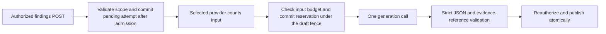

# Gemini findings provider — finalized design

**25 November 2026 · Design finalized.** Baseline is merged main at `9fb015c1d1f8beb24a35b44e281994d31f96baf9`. The owner approved the Gemini architecture and asked for the daily limit to survive backend restarts. The approved provider choices are recorded in D-036. This design specifies how the existing generation history will enforce the daily limit. Implementation requires separate authorization and starts with offline verification. Live calls require a later authorization. [PRD](PRD_V0.1.md#8-ai-behavior-and-responsibilities), [Task 5 contract](SYSTEM_ARCHITECTURE_V0.1.md#5-task-5-initial-ai-findings--design-for-owner-review), [D-036](DECISION_LOG.md#approved-gemini-findings-design)

## 1. Model and API selection

| Candidate | Google documentation on 25 November 2026 | OpsPilot trade-off |
|---|---|---|
| **Gemini 3.5 Flash-Lite (`gemini-3.5-flash-lite`)** | Stable, structured text output, Free-tier Standard text input and output, and an explicit `minimal` thinking level. | Selected. The model is optimized for low latency, and the assignment is to synthesize at most 14 already-selected records into a small report. Its ability to distinguish an internal attempt, a provider capture, and a bank debit still needs evaluation. [Model](https://aistudio.google.com/docs/models/gemini-3.5-flash-lite), [pricing](https://aistudio.google.com/docs/pricing#gemini-3.5-flash-lite), [thinking levels](https://aistudio.google.com/docs/thinking#thinking-levels) |
| Gemini 3.8 Flash (`gemini-3.8-flash`) | Stable, structured output, Free-tier Standard text input and output. | Candidate for a later deliberate comparison if Flash-Lite misses reference cases. Google positions it for more complex work. It has a higher paid list price and lacks the `minimal` level. [Model](https://aistudio.google.com/docs/models/gemini-3.8-flash), [pricing](https://aistudio.google.com/docs/pricing#gemini-3.8-flash), [thinking levels](https://aistudio.google.com/docs/thinking#thinking-levels) |
| Gemini 4 Hydrogen (`gemini-4-hydrogen`) | Stable, structured output, Free-tier Standard text input and output. | A current reasoning candidate with a larger thinking range. The existing short request deadline and small evidence task favor starting with Flash-Lite. [Model](https://aistudio.google.com/docs/models/gemini-4-hydrogen), [pricing](https://aistudio.google.com/docs/pricing#gemini-4-hydrogen), [thinking levels](https://aistudio.google.com/docs/thinking#thinking-levels) |

Google limits Gemini 2.5 access to prior users and documents automatic routing of `gemini-2.5-flash` to 3.5 Flash-Lite from 1 December 2026. Pin the explicit 3.5 Flash-Lite ID and review its lifecycle before enabling. Project-specific availability and usable capacity must be checked in AI Studio. [Model catalog](https://aistudio.google.com/docs/models), [deprecations](https://aistudio.google.com/docs/deprecations), [rate limits](https://aistudio.google.com/docs/rate-limits)

Use the Gemini Developer API at explicit `v1`, with the official asynchronous Python **Google Gen AI SDK** (`google-genai`) for one non-streaming `generateContent` request and the documented REST `countTokens` route for preflight. `google-genai==3.6.1` is a candidate for lock resolution and wire tests. Pin explicitly before implementation acceptance. GenerateContent matches OpsPilot's single request-bound turn and gives the count endpoint a matching full-request format. Google recommends Interactions for new projects, and its lifecycle would be useful for multi-turn or long-running work. It introduces a different request and response contract for this slice. Using REST for both operations could simplify wire parity and avoid adding an SDK dependency, at the cost of owning both integrations directly. The SDK path teaches provider integration while retaining a narrow REST exception for full-request counting. [SDK guide](https://aistudio.google.com/docs/libraries), [SDK release](https://github.com/googleapis/python-genai/releases/tag/v3.6.1), [GenerateContent API](https://aistudio.google.com/api-reference/generate-content/generate-content?api-version=v1), [Interactions API](https://aistudio.google.com/api-reference/interactions-api)

## 2. Provider boundary and data flow

Task 5A separates generating text from publishing findings. [`FindingsProvider`](../backend/app/findings_provider.py) returns a count and a provider result. [`findings.py`](../backend/app/findings.py) owns authorization, evidence, deadlines, validation and database transactions. Task 5B's [`openai_findings_provider.py`](../backend/app/openai_findings_provider.py) translates the OpenAI wire shapes. The current workflow also builds OpenAI request options, looks up one OpenAI price map, assumes an OpenAI-or-mock count kind and uses an OpenAI-specific cost predicate. These are the seams to extend.

- Add `gemini` to the server-side provider selection and the additive history provider enum. Keep `AI_FINDINGS_ENABLED=false` and the existing `mock` default. Propose a Gemini-only `AI_FINDINGS_GEMINI_MODEL` defaulting to the single allowlisted model. `AI_FINDINGS_MODEL` retains its Task 5B meaning. Only an enabled Gemini selection may initialize the Gemini adapter and load `GEMINI_API_KEY` as a server-side secret. Missing or incompatible configuration fails closed for generation. Close the selected live client in the application lifespan. Clients of OpsPilot cannot choose a provider, model, endpoint, tier, or key.
- Keep one evidence assembly path. Persist the exact bounded synthetic bundle and digest with the selected provider's actual instructions, schema and options. Use a small provider-specific branch for request options and the count/pricing policy. Preserve `mock_estimate`, `openai_input_tokens`, and the OpenAI request, reservation and accounting semantics. Add a distinct `gemini_count_tokens` kind. Keep the configured model and an approved returned identity in the current history fields. Accept the selected Gemini model's exact ID initially, with any documented version alias requiring explicit review. Persist a bounded, allowlisted `responseId` internally if present. Reject conflicting or missing model identity before publication. Use the attempt's persisted policy when finalizing or reading historical rows, independent of today's selection. Existing PostgreSQL provider/model text and JSON metadata columns support this scope.
- Keep the existing POST and provider-free GET. The POST assembles only the selected completed/partial evidence request in an owned current case/thread/state, including six original source outcomes, exact membership and eligible relationships. Preserve request security guards, session checks, retry references, draft-version fences, and the existing per-case attempt allowance. Run external calls after the start transaction commits and outside open database transactions. Reauthorize before reservation and at finalization. Commit the validated graph and successful terminal state together. Failures preserve safe attempt history. A valid empty result consumes the same initial slot as a populated result. GET recovers a result after an ambiguous client disconnect, including when a different provider is configured or generation is disabled.

## 3. Gemini wire differences and failure behavior

| Area | Gemini behavior |
|---|---|
| Request and schema | Send the existing server-owned instructions as `systemInstruction`, and the selected bundle as one user text message. Request one candidate, `application/json` and a native JSON Schema through `response_mime_type` and `response_json_schema` in the candidate SDK. Use `thinkingLevel=MINIMAL`, leave thought summaries disabled, and set `maxOutputTokens=3000` initially. Build the provider schema from `FindingGenerationOutput`. Retain required keys, core types, literal/enum values, closed objects and the nullable reason where supported. Keep all strict Pydantic constraints and validators, including lengths, cardinality and cross-field rules. Google documents a schema subset and a grammar complexity limit. If necessary, simplify only the provider projection and test that the existing validator still rejects each relaxed constraint. Schema rejection is a safe configuration failure. [SDK serializer](https://github.com/googleapis/python-genai/blob/v3.6.1/google/genai/models.py#L1210-L1287), [structured output](https://aistudio.google.com/docs/structured-output), [thinking](https://aistudio.google.com/docs/thinking) |
| Token preflight | OpenAI counts the Responses request with its instructions and schema. Gemini returns `totalTokens` for its count request. The SDK's typed Developer API `count_tokens` rejects `system_instruction`, while the public REST endpoint accepts a nested `generateContentRequest`. Use the documented `v1` full-request form with the same model, role/text, instructions, and generation config including the schema. Assert parity with the SDK-generated request on a fake transport. Require a positive bounded integer with no coercion. Fail before generation if preflight fails or exceeds the 12,000-input-token limit. Preflight counts input only and may differ from generation's reported prompt usage even for matching requests, including differences in schema overhead. Generation also reports output and thinking usage. Reject publication if trustworthy reported input exceeds the configured bound. Compare count and prompt usage in later live acceptance and investigate systematic drift before enabling routine use. One count is the complete preflight. [CountTokens request](https://aistudio.google.com/api-reference/tokens/count-tokens?api-version=v1), [GenerateContent usage metadata](https://aistudio.google.com/api-reference/generate-content/generate-content?api-version=v1#Resource:UsageMetadata), [SDK count serializer](https://github.com/googleapis/python-genai/blob/v3.6.1/google/genai/models.py#L297-L321) |
| Response envelope | OpenAI exposes an overall status and typed output items. Inspect Gemini's raw envelope before using candidate text or SDK shortcuts. Accept exactly one candidate with `finishReason=STOP` and non-empty text parts in order. Discard thought text/signatures and reject unexpected non-text parts such as calls or executable code. A blocked prompt or safety/recitation stop maps to `AI_REFUSED`; `MAX_TOKENS` maps to `AI_OUTPUT_INCOMPLETE`; an absent/ambiguous candidate, malformed envelope or unrecognized finish value maps to a safe invalid-output failure. Never publish a partial JSON result. [GenerateContent response reference](https://aistudio.google.com/api-reference/generate-content#response-body), [SDK raw response path](https://github.com/googleapis/python-genai/blob/v3.6.1/google/genai/models.py#L6366-L6375) |
| Output and evidence | Decode the original response text using the existing bounded JSON path with duplicate-key rejection, then run strict Pydantic validation and `validate_references`. Resolve each record and RFC 6901 pointer against the selected response's exact membership and retained fields. Validate citation indexes and source references and preserve server-supplied limitations. Valid locators establish traceability. Findings remain `awaiting_review`. Before accepting a model-generated payment conclusion, a human reviewer must check whether the cited fields and source coverage support the exact claim, its attribution, and its financial inference. For example, two attempt records and one observed capture cannot establish two bank debits. The review UI remains a separate increment. [Product requirements](PRD_V0.1.md#9-evidence-traceability-uncertainty-and-attribution) |
| Usage and accounting | Normalize allowlisted `usageMetadata` counters after validating raw nonnegative integers and total consistency. Map `promptTokenCount` to input (it already includes cached input), `candidatesTokenCount` plus `thoughtsTokenCount` to output, and retain allowed cache/thinking breakdowns and `totalTokenCount`. For a tool-free request, a nonzero `toolUsePromptTokenCount` is anomalous. Apply Google field semantics for omitted optional counters and retain null usage when counts are missing or inconsistent. Never expose raw usage payloads, thoughts or response IDs. Under the proposed Free policy the expected token charge used for admission is $0.00 after valid preflight. Save it as an estimate with reviewed tariff provenance, and leave actual Gemini cost null because usage counters do not attest to billing tier or invoice cost. Timeout and absent usage stay unknown. OpenAI retains its own pricing and actual-cost predicate. [UsageMetadata](https://aistudio.google.com/api-reference/generate-content#Resource:UsageMetadata), [pricing](https://aistudio.google.com/docs/pricing#gemini-3.5-flash-lite) |
| Timeouts and errors | Start with existing 3-second count, 10-second generation, 20-second total work deadline and 6-second publication reserve. Shorten each call to remaining UTC/monotonic budget and enforce the outer async timeout. The SDK `HttpOptions.timeout` takes milliseconds, while the direct HTTP client and workflow use seconds. Explicitly set SDK retry attempts to **one total attempt**, with zero transport retries. Map 429 to the existing `AI_PROVIDER_RATE_LIMITED` outcome, 408/504 or a local timeout to the existing deadline handling, invalid project/auth/model/request errors to safe configuration failures, and upstream transient/connection failures to the existing safe categories. A timeout can leave Google processing the request. Keep error detail allowlisted and use manual retry only, subject to current workflow eligibility. [SDK timeout conversion](https://github.com/googleapis/python-genai/blob/v3.6.1/google/genai/_api_client.py#L355-L365), [SDK retry handling](https://github.com/googleapis/python-genai/blob/v3.6.1/google/genai/_api_client.py#L750-L758), [Google API errors](https://aistudio.google.com/docs/api-errors) |

## 4. Free-tier safeguards

- **Provider quotas.** Google enforces project quotas for the selected model independently of OpsPilot. Check actual project/model availability, requests per minute, input tokens per minute, and requests per day in AI Studio before a separately authorized live check. Google's daily quota resets at midnight Pacific. OpsPilot uses a rolling 24-hour window. Stay within whichever limit is tighter and allow headroom for both endpoint calls. A Google 429 consumes the admitted start and returns the existing safe provider error. Consult the dashboard before any manual retry. [Google rate-limit guide](https://aistudio.google.com/docs/rate-limits), [project rate-limit dashboard](https://aistudio.google.com/rate-limit)
- **Billing.** The local attempt limit does not guarantee zero billing. Before live use, verify separately that the dedicated `opspilot-ai` project is on **Free** with no active billing linkage or paid enrollment. Recheck before enabling use after any project or billing change. Free-tier prices apply to eligible requests under Google's terms and active quota. The model ID and local $0.00 estimate cannot establish what Google will bill. Keep initial use private and local. [AI Studio billing](https://aistudio.google.com/billing), [billing guide](https://aistudio.google.com/docs/billing)
- Keep one explicit POST per attempt, the five-attempt default per case, the existing record/byte limits, and one capped generation following a successful count. Startup, GET, reload, retrieval, and health checks trigger zero model calls. A lost response is resolved with GET. A subsequent manual attempt uses the current draft version and the existing retry rules. No automatic retries, provider/model fallback, repair calls, tools, grounding, file uploads, explicit caching, conversation state, or paid processing options are part of this scope.
- Use only pinned synthetic data and the fixed HTTPS Google Developer API destination. Pass authentication in `x-goog-api-key`; disable ambient endpoint/header/proxy overrides, redirects and cookie persistence. Suppress SDK/transport logging of bodies, headers and raw exceptions. Provider calls carry no visitor credential or database connection details. Google's terms describe product improvement use for Unpaid Services, so the synthetic-data boundary applies to both preflight and generation. For perspective, listed paid Standard rates are $0.30 input and $2.50 output per million tokens including thinking. An illustrative 12,000 input and 3,000 billed output tokens would cost $0.0111 at those rates. The Free-project billing configuration is the protection against paid use. [Google key handling](https://aistudio.google.com/docs/api-key), [Unpaid Services terms](https://aistudio.google.com/docs/terms#data-use-unpaid), [model pricing](https://aistudio.google.com/docs/pricing#gemini-3.5-flash-lite)

### 4.1 Durable Gemini admission

Apply a maximum of **five admitted Gemini starts per rolling 24 hours** across visitors, cases and workers sharing the private deployment's PostgreSQL database and findings tables. Retain the one-start-per-rolling-minute pacing and allow only one unexpired pending Gemini attempt. The pending check limits active application attempts. Google may continue processing a timed-out request.

1. Run existing authentication, ownership, draft, evidence and input-size checks. Near the end of the existing start transaction, after taking the investigation lock, take a fixed, namespaced PostgreSQL transaction advisory lock for the single Gemini deployment. A transaction advisory lock is an application-defined mutex that PostgreSQL releases at commit or rollback. Use the try-lock form for bounded contention. [PostgreSQL advisory locks](https://www.postgresql.org/docs/18/functions-admin.html#FUNCTIONS-ADVISORY-LOCKS)
2. With the lock held, sample PostgreSQL `clock_timestamp()` once and read recent committed `ai_generation_requests` in a subsequent statement under `READ COMMITTED`. This lets a worker see the prior lock holder's commit. Filter by `provider = gemini` across all owners and models for this deployment. Count each row with `requested_at` strictly newer than the sampled time minus **24 elapsed hours**. A row exactly 24 hours old has aged out. Apply the same boundary at 60 seconds for pacing and check for any `pending` Gemini row with `deadline_at` later than the sampled time. Use the sampled time for the new row's `requested_at`. [PostgreSQL transaction isolation](https://www.postgresql.org/docs/18/transaction-iso.html#XACT-READ-COMMITTED), [PostgreSQL time functions](https://www.postgresql.org/docs/18/functions-datetime.html#FUNCTIONS-DATETIME-CURRENT)
3. If admitted, insert the existing pending attempt and commit the normal draft-version advance in that transaction. The committed row is the admission record. Only after the commit succeeds may the handler send the preflight. Every committed start counts until it ages out, including count failures, interrupted or stale attempts, upstream 429s, and a crash after commit but before the first call. A rolled-back start creates no admission record. The database lock ends before any external call.
4. A full window, pacing limit, active attempt or lock contention returns a safe, retryable HTTP 429 such as `AI_LOCAL_RATE_LIMITED` through the existing error envelope. Rejection inserts no row for the new request and sends neither outbound call. Keep the existing safe database failure if the check or commit cannot complete. The public response omits other visitors' quota activity.

Reusing attempt history ties enforcement and audit to one write. Process memory would be simpler and would discard the window on restart. A separate counter table or shared quota service could support multiple projects, at the cost of another persistence model and lifecycle. This slice uses one dedicated Google project and one persistent database, with no added table or service. All Gemini workers must use the same admission path and lock key. Keep admission rows for at least the full window. A database reset, restore to an older snapshot, or separate deployment using the same Google project lies outside the guarantee. An admitted start permits at most two outbound calls, so five admitted starts can allocate up to ten calls. Their dispatch times and any traffic outside this deployment determine how Google meters them.

## 5. Implementation plan and offline verification

1. **Wire selection and policy.** Update `backend/app/config.py`, `main.py`, `findings_provider.py`, `findings_schemas.py`, and `findings.py` for the provider, count kind, model-specific request options, and pricing/history. Add the Gemini admission check to the existing start transaction. Keep the existing routes, Pydantic findings contract, reference validator and six findings tables. Setup changes are the SDK dependency in `backend/pyproject.toml` and the dev lock, placeholder-only `.env.example` entries, and backend setup notes. Frontend, migration, queue, or framework work is outside this increment.
2. **Add one Gemini adapter and focused fake-transport tests.** Put vendor logic in `backend/app/gemini_findings_provider.py` and tests in `backend/tests/test_gemini_findings.py`, following Task 5B's fake HTTP tests. Intercept both endpoints with an egress-denying fixture and a dummy key. Verify the serialized full-request count matches generation options and inputs, with exactly one count and at most one generation. Assert model ID, JSON mode plus schema, candidate count, output limit, timeout units, no retries, no ambient credentials/endpoint override, and no cookies or raw-response leakage. Prove denied local admission sends zero requests and a failed or over-limit count prevents generation. Cover 429, timeout/cancellation, 4xx/5xx, blocked/truncated/ambiguous candidates, model mismatch, missing/malformed usage, and both valid and invalid JSON.
3. **Exercise the findings routes against local PostgreSQL.** Race two different authorized investigations for the fifth slot from independent database connections. Prove at most one wins, then recreate the backend against the same database and prove a sixth remains blocked even after the minute window passes. Use controlled timestamps for the exact 60-second and 24-hour boundaries. Verify committed starts survive failure, interruption, and simulated crash-before-dispatch, and rolled-back starts consume neither a slot nor a provider call. Test unexpired pending admissions, lock contention, and database errors. Verify successful and empty atomic publication, provider-free reload, manual retry, stale-state/session fencing and zero calls for unauthorized or duplicate operations. Exercise malformed output and invalid citations and assert zero partial publication. Run mock and OpenAI regressions, the backend suite, Ruff, dependency compatibility and the Alembic schema check. These are future acceptance checks.
4. **Reuse the reference cases for a separately authorized evaluation.** Offline, replay curated Gemini-shaped responses for payment timeout (unknown outcome), candidate duplicate attempts (attempts and capture vs. bank posting), partial Stripe retrieval, missing bank evidence, and valid no-findings. Include a schema-valid claim with real but irrelevant citations in the semantic review rubric. A future limited live check should measure latency, count-to-usage drift, finish reasons and material unsupported claims. Evaluate provenance and payment semantics across claims and explanations, with any invented financial outcome or root cause failing review. Offline fixtures establish integration behavior. Account entitlement, server schema acceptance and actual model judgment require the separate live check. [Approved reference cases](SYSTEM_ARCHITECTURE_V0.1.md#57-reference-evidence-evaluation-set-and-acceptance)

## 6. Remaining implementation risks

- Every Gemini start path must take the same lock before reading recent admissions. Verify the isolation level and restart/concurrency behavior in PostgreSQL. The existing indexes serve case-scoped history, so check the project-wide query cost within existing database timeouts before considering an index. Reliable elapsed windows depend on a stable database clock and retained history.
- The SDK pin is a candidate until its dependency lock and fake-transport results are verified. Actual project/model availability, provider schema acceptance, returned model identity, token-count drift, and latency require separately authorized live checks. Revisit the model or output settings if results truncate or miss the reference cases. [Model lifecycle](https://aistudio.google.com/docs/deprecations)
- A future shared deployment, multiple Google projects, or changes to data retention would alter the admission assumptions and require review. For payment conclusions, the evaluation set and individual human review remain necessary even when every reference resolves.
