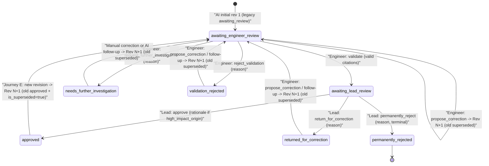

# OpsPilot AI — Human Findings Review MVP: Gap Analysis & UX/System-Design Handoff

**Date:** 27 November 2026\
**Status:** Design handoff updated with accepted ADR-037 (planning only; no code or migrations implemented)\
**Inputs:** [`OpsPilot_AI_Human_Findings_Review_MVP_PRD.md`](OpsPilot_AI_Human_Findings_Review_MVP_PRD.md), [`DECISION_LOG.md`](DECISION_LOG.md), [`ADR-037`](decisions/ADR-037-engineer-lead-identity-and-shared-workspace-authorization.md), [`SYSTEM_ARCHITECTURE_V0.1.md`](SYSTEM_ARCHITECTURE_V0.1.md), [`DOMAIN_MODEL_ERD_V0.1.md`](DOMAIN_MODEL_ERD_V0.1.md), [`UX_BLUEPRINT_V0.1.md`](UX_BLUEPRINT_V0.1.md), [`PROJECT_STATUS.md`](PROJECT_STATUS.md), and inspected repository code under `backend/` and `frontend/`.

---

## 1. Repository Inspection Summary

### 1.1 Implemented Backend Capabilities
- **Database schema (`0001`–`0005`):** 23 domain tables in [`backend/app/models.py`](../backend/app/models.py), including `visitor_contexts`, `dataset_versions`, `incidents`, `investigations`, `investigation_states`, `working_drafts`, `thread_states`, `state_sources`, `evidence_records`, `payment_cases`, `case_threads`, `case_evidence_links`, `evidence_relationships`, `evidence_requests`, `request_sources`, `retrieval_results`, `retrieval_result_records`, plus Task 5A's six tables (`ai_generation_requests`, `findings`, `finding_cases`, `ai_proposals`, `evidence_citations`, `assessment_result_refs`).
- **Findings generation & citations ([`backend/app/findings.py`](../backend/app/findings.py), [`findings_schemas.py`](../backend/app/findings_schemas.py), [`findings_validation.py`](../backend/app/findings_validation.py)):**
  - Explicit `POST .../finding-generations` and provider-free `GET .../findings` scoped to `(investigation_id, state_id, thread_kind, case_id)`.
  - Supports `mock`, `openai`, and `gemini` behind `FindingsProvider`, disabled by default (`AI_FINDINGS_ENABLED=false`, `AI_FINDINGS_PROVIDER=mock`).
  - Strict Pydantic `FindingGenerationOutput` (`task5.v1`) + `validate_references()` validating RFC 6901 JSON Pointers (`/payload/` or `/timestamps/`) against exact returned `retrieval_result_records` of the selected `evidence_request_id`.
  - Durable admission and budget controls (`AI_FINDINGS_MAX_ATTEMPTS_PER_CASE=5`, Gemini rolling 24h/5-start PostgreSQL advisory lock, `draft_version` optimistic concurrency, `SELECT ... FOR UPDATE` on `investigations`, overdue reconciliation).
- **State & permissions ([`backend/app/visitor_sessions.py`](../backend/app/visitor_sessions.py), [`main.py`](../backend/app/main.py)):**
  - Anonymous D-019 cookie authentication (`__Host-opspilot_visitor` or `opspilot_visitor` on opt-in local HTTP), 256-bit random token, SHA-256 hash stored on `visitor_contexts`, 24h TTL.
  - Strict single-visitor isolation: `UQ (visitor_context_id, incident_id)`; foreign or unknown IDs return `404 NOT_FOUND`.
  - **No user accounts, actor identities, or `Engineer` / `Lead` roles exist.**
  - HTTP middleware in [`main.py`](../backend/app/main.py) enforces `Origin`, `X-OpsPilot-Request: 1`, `Content-Type: application/json`, and a **4 KiB body cap** on `POST` requests only.

### 1.2 Implemented Frontend Capabilities
- [`WorkspaceShell`](../frontend/app/workspace-shell.tsx): Incident header, desktop thread/case rail, mobile `<dialog>` drawer, `Overview` / `Evidence` tabs, and a disabled `Findings Unavailable` button.
- [`CaseWorkspace`](../frontend/app/case-workspace.tsx) & [`workspace-navigation.ts`](../frontend/lib/workspace-navigation.ts): Local state/history/scroll restoration scoped to `(investigation_id, state_id, dataset_version_id, fixture_digest)`, `CaseLocation.view` restricted to `"overview" | "evidence"`.
- [`CaseList`](../frontend/app/case-list.tsx) & [`investigations.ts`](../frontend/lib/investigations.ts): Renders `CaseSummary` rows; **hardcodes `"not_started"`** (`parseCaseList` rejects any other `investigation_progress` value; UI displays `Review: Not started`).
- [`EvidencePanel`](../frontend/app/evidence-panel.tsx) & [`EvidenceView`](../frontend/app/evidence-view.tsx): Explicit inspection/retry, 4 source groups, 6 source outcomes, inline expandable records with DOM IDs `#evidence-${idPrefix}${evidence_record_id}` and `revealEvidenceRecord()`, and relationship deep links.

---

## 2. PRD Gap Analysis & Conflict Register

### 2.1 Capability Comparison

| PRD Requirement | Current Repo State | Gap / Action Needed |
|---|---|---|
| **FR-01** Findings overview | Backend has case-scoped `GET .../cases/{case_id}/findings` only; frontend `Findings` tab is disabled | Add investigation/thread-level findings overview endpoint; enable `Findings` tab; render status/impact/revision/stage summary, filters, and loading/empty/error states |
| **FR-02** Evidence inspection | `EvidenceCitation` resolves RFC 6901 pointers to `retrieval_result_records`; `EvidenceView` supports `#evidence-...` reveal | Map citation pointers from Findings UI into Evidence records (or inline citation preview); detect and flag broken/missing citations and block Engineer validation when unresolved |
| **FR-03** Engineer decisions | `StoredFinding.review_state` is hardcoded `"awaiting_review"`; no review endpoints exist | Implement Engineer actions (`validate`, `request_further_investigation`, `reject_validation`) with mandatory nonblank reasons for non-validation and server-side state validation |
| **FR-04** Human corrections | `findings` table enforces one row per `(state_id, thread_kind, logical_finding_ref)` and immutable `claim` | Add immutable `finding_revisions` model supporting `ai`, `human_corrected`, and `ai_followup` revisions with parent links, `change_reason`, and zero review transfer |
| **FR-05 / FR-06** Lead queue & decisions | No Lead role, queue, or approval/return/rejection workflow | Implement Lead Queue returning only `awaiting_lead_review` non-superseded current revisions + Lead `approve`, `return_for_correction`, and terminal `permanently_rejected` |
| **FR-07** Guarded bulk approval | Not implemented | Implement bulk approval endpoint + UI enforcing current validated revisions, mandatory `high_impact_origin` rationales, individual audit events, and explicit per-item results |
| **FR-08** Revision history & supersession | `investigation_revisions` deferred; no finding-level revision history | Add per-finding immutable revision history (`Rev 1..N`), `is_superseded` version property (preserving historical approval), diff comparison, and original AI preservation |
| **FR-09 / FR-10** Deterministic impact engine & human review | Not implemented; `synthetic-payments-v0.1` has 5-min aggregate metric (`62/500 = 12.4%`), no customer counts, no 4-week baseline | Build versioned ruleset engine evaluating 5 critical-risk triggers + numeric thresholds; explicitly emit `insufficient_data`/`unavailable`/`needs_assessment` on missing prerequisites; enforce `high_impact_origin` rationale rule |
| **FR-11** Role-based permissions | Anonymous `visitor_contexts` only; no Engineer/Lead roles; single-visitor investigation isolation | Introduce server-side actor identity & `engineer`/`lead` role model (requires owner approval — see Conflict 3) |
| **FR-12** Append-only audit trail | `ai_generation_requests` & `evidence_requests` log execution only; no review audit events | Add append-only `finding_review_events` recording actor, role, timestamp, revision, decision, reason, and before/after state |
| **FR-13** AI/manual follow-up | `uq_ai_generation_completed_scope` blocks >1 completed generation per case/thread/state | Add explicit follow-up path for `needs_further_investigation` / `returned_for_correction` honoring existing budgets/quotas without breaking initial-slot protection |
| **FR-14** Failure & concurrency safety | `draft_version` + `SELECT ... FOR UPDATE` on `investigations` | Extend locking to `expected_revision_id` + `expected_draft_version` + `idempotency_key` on all review/bulk commands |

### 2.2 Reusable Components
- **Concurrency & transaction patterns:** `owned_draft()`, `advance()`, `reconcile_overdue()`, `APIError` envelope, `X-Request-ID`, `Cache-Control: no-store`.
- **Evidence & citation primitives:** `resolve_pointer()`, `EvidenceRecordView`, `SourceOutcome`, `EvidenceView`, `revealEvidenceRecord()`, and `#evidence-...` DOM anchors.
- **Provider & safety stack:** `FindingsProvider` (`mock`/`openai`/`gemini`), `FindingGenerationOutput` strict schema, `validate_references()`, and offline mock tests.

### 2.3 Identified Technical Constraints & Conflicts (PRD Decisions Preserved)
1. **`uq_finding_logical` & `findings.generation_id` NOT NULL:** [`models.py`](../backend/app/models.py#L588-L602) allows only one `Finding` row per `(state_id, thread_kind, logical_finding_ref)` and ties `Finding` directly to `ai_generation_requests` and `EvidenceCitation` to `(ai_proposals.state_id, proposal_id, evidence_request_id)`. **Resolution:** Keep Task 5A tables as the immutable AI-generation origin and introduce `logical_findings`, `finding_revisions`, and `finding_revision_citations` alongside them (backfilled for existing rows).
2. **`uq_ai_generation_completed_scope` vs AI-assisted follow-up (PRD Decision 4, FR-13):** Existing partial unique index allows at most one `completed` generation per `(state_id, thread_kind, case_id)`. **Resolution:** Retain that uniqueness for `generation_kind = 'initial'`, and scope follow-up generations (`generation_kind = 'followup'`) to an explicit `follow_up_of_logical_finding_id` only when the current revision is `needs_further_investigation` or `returned_for_correction`.
3. **Anonymous `visitor_contexts` (D-018/D-019) vs Independent Engineer & Lead Roles (PRD Decisions 1, 8, 30; FR-11):** Existing auth isolates investigations per anonymous cookie (`UQ (visitor_context_id, incident_id)`), so an independent Lead cannot view or approve an Engineer's investigation. **Resolution ([ADR-037 / D-037](decisions/ADR-037-engineer-lead-identity-and-shared-workspace-authorization.md), Accepted):** Retain `visitor_contexts` as the shared workspace boundary and add server-verified `workspace_actors` (`engineer` / `lead`) + `actor_sessions` scoped to that workspace, preserving cross-workspace `404` isolation, blocking Engineer access/minting of Lead credentials, and restricting legacy `/visitor-session` to `engineer`-only. Never trust client-supplied role headers.
4. **`awaiting_review` & hardcoded `not_started`:** Map legacy `awaiting_review` to initial revision status `awaiting_engineer_review`, and compute `CaseSummary.investigation_progress` (`not_started | in_progress | reviewed`) dynamically from active non-superseded revisions (updating `frontend/lib/investigations.ts` and `CaseList`).
5. **`D-034` / `UX_BLUEPRINT_V0.1.md` deferral vs new MVP PRD:** `D-034` deferred Findings, human review, and filters; the older Findings screen docs (`PAYMENT_FAILURES_FINDINGS_SCREEN_V0.1.md`, `POSSIBLE_DUPLICATES_FINDINGS_SCREEN_V0.1.md`) also assumed a 3rd-column AI assistant and single-stage `Accept/Correct`. **Resolution:** This MVP supersedes `D-034`'s deferral of Findings, Human Review, Finding Revisions, and Findings Filters, while **retaining** deferrals of the AI Assistant panel, whole-investigation Save/Refresh/Export (`investigation_revisions`), and remediation execution.
6. **Synthetic dataset vs PRD Impact Thresholds (PRD Risk #3, Decisions 15–26):** In [`synthetic-payments-v0.1.json`](../backend/fixtures/synthetic-payments-v0.1.json), `SYN-GRAF-METRIC-001` only provides a 5-minute window (`62/500 = 12.4%`), `"Unique-customer counts": "Not constructed"`, SGD 48.00 / SGD 120.00 ticket amounts, and **zero** 4-week historical baseline windows. **Resolution:** Keep `synthetic-payments-v0.1` frozen (D-016); verify that on `synthetic-payments-v0.1`, the baseline rule reports `insufficient_data` / `unavailable`, customer count reports `unknown` (`needs_assessment`), and `CASE-DUP-001` evaluates the duplicate-charge critical-risk trigger cleanly. Add **separate deterministic test fixtures** for all numeric threshold branches (`>=20%` over 15m/`>=100`, `>=3x` & `+5pp` with `3/4` windows, `>=100` customers, `>=USD 10,000` exposure).
7. **HTTP `POST`-only middleware & 4 KiB cap ([`main.py`](../backend/app/main.py#L125-L154)):** Use `POST` for all new mutation commands so `Origin`, `X-OpsPilot-Request: 1`, and JSON checks apply automatically, and review whether human-correction / bulk-approval routes need a 16–32 KiB limit (vs 4 KiB).

---

## 3. Proposed Revision, State-Transition & Data Model

### 3.1 Logical Finding & Immutable Revision Entities (Candidate Migration `0007_human_findings_review`, after `0006_actor_auth`)
All new tables remain `state_id`-scoped (composite PKs/FKs) for future D-013 copy-on-save compatibility:
- **`logical_findings`** — PK `(state_id, logical_finding_id)`: `thread_kind`, `logical_finding_ref`, `origin_finding_id?` (links to Task 5A `findings`), `is_permanently_rejected` (bool, default `false`), `current_revision_id` (FK to `finding_revisions`).
- **`finding_revisions`** — PK `(state_id, revision_id)`, UQ `(state_id, logical_finding_id, revision_no)`:
  - `parent_revision_id?`, `source` (`ai | human_corrected | ai_followup`), `origin_generation_id?`, `origin_proposal_id?`, `origin_evidence_request_id?`.
  - Immutable content: `claim`, `kind`, `proposed_status`, `rationale` (JSONB), `limitations` (JSONB), `next_questions` (JSONB), `change_reason` (mandatory nonblank when `source != 'ai'`), `created_by_actor_id?`, `created_at`.
  - Lifecycle state: `review_status` (`awaiting_engineer_review | needs_further_investigation | validation_rejected | awaiting_lead_review | returned_for_correction | approved | permanently_rejected`).
  - **Version property (PRD §6):** `is_superseded` (bool, default `false`), `superseded_at?`, `superseded_by_revision_id?`. Prior `approved` revisions preserve `review_status = 'approved'` while `is_superseded = true`.
- **`finding_revision_citations`** & **`finding_revision_result_refs`**: Revision-owned citations (preserving `copied_from_citation_id?` and optional `retrieval_result_records` link) and source-outcome references, avoiding Task 5A's `ai_proposals`-only FK restriction.
- **`finding_impact_assessments`** — PK `(state_id, assessment_id)` per revision: `ruleset_version`, `system_classification` (`routine | high_impact | needs_assessment`), `high_impact_origin` (bool, latched true if any critical trigger or numeric threshold initially flags high impact), `trigger_hits` (JSONB), `threshold_results` (JSONB including explicit `insufficient_data`/`unavailable` prerequisites), `engineer_recommended_classification?`, `engineer_reason?`, `lead_confirmed_classification?`, `lead_override_reason?`.
- **`finding_review_events`** — Append-only audit table: `(state_id, event_id)`, `logical_finding_id`, `revision_id`, `event_type`, `actor_id`, `actor_role`, `prior_review_status`, `new_review_status`, `prior_superseded`, `new_superseded`, `reason`, `impact_snapshot` (JSONB), `bulk_batch_id?`, `idempotency_key?`, `created_at`.

### 3.2 Revision State Transitions

**Core invariants enforced in DB + transaction services:**
1. Only `is_superseded = false` and `logical_finding.is_permanently_rejected = false` revisions accept review decisions.
2. Any edit to `claim`, `proposed_status`, `rationale`, or `citations` creates `Rev N+1`, marks `Rev N` `is_superseded = true`, resets `review_status = awaiting_engineer_review`, and never carries forward validation or approval.
3. `high_impact_origin = true` latches at creation/re-evaluation; even if Lead overrides down to `routine` (with required `override_reason`), Lead `approve` still requires a nonblank written rationale (PRD Decision 27).

---

## 4. Proposed Engineer / Lead Authorization Matrix

> **Accepted Decision ([ADR-037 / D-037](decisions/ADR-037-engineer-lead-identity-and-shared-workspace-authorization.md)):** Existing `visitor_contexts` remains the shared workspace boundary while `workspace_actors` (`engineer`/`lead`) and `actor_sessions` provide server-verified actor identity and role separation so an independent Lead can view and decide on Engineer-validated findings without weakening cross-workspace isolation. Engineer sessions cannot obtain or mint Lead credentials, legacy `/visitor-session` stays `engineer`-only, and Task 6A is backend-only.

| Action / Endpoint | Unauthenticated | Wrong Workspace | Engineer | Lead | Extra Guardrail |
|---|---|---|---|---|---|
| View Findings Overview / Detail / History / Audit | `401` | `404` | Allowed | Allowed | Reconciles overdue work on current draft |
| Generate initial AI findings / AI follow-up | `401` | `404` | Allowed | `403` | Explicit user trigger; respects 5-attempt & Gemini limits |
| Engineer: `validate` / `request_further_investigation` / `reject_validation` | `401` | `404` | Allowed | `403` | `validate` blocked (`409/422`) if any citation is broken/missing |
| Engineer: `propose_correction` | `401` | `404` | Allowed | `403` | Blocked (`409`) if `permanently_rejected`; requires `change_reason` |
| Engineer: recommend impact adjustment | `401` | `404` | Allowed | `403` | Cannot finalize classification; reason required |
| View Lead Queue (`awaiting_lead_review` only) | `401` | `404` | `403` (or read-only empty/hidden; API restricted) | Allowed | Returns only non-superseded `awaiting_lead_review` revisions |
| Lead: `approve` / `return_for_correction` / `permanently_reject` | `401` | `404` | `403` | Allowed | **Self-approval guard:** `lead.actor_id != revision.created_by_actor_id` and `!= validating_engineer_id`; mandatory rationale on high-impact origin, return, and permanent rejection |
| Lead: `confirm/override` impact classification | `401` | `404` | `403` | Allowed | Override requires written reason |
| Lead: `bulk-approve` | `401` | `404` | `403` | Allowed | Per-item validation, mandatory rationale check per `high_impact_origin` item, per-item audit event & result |

---

## 5. Proposed Frontend Screens & Minimal API Contracts

### 5.1 Frontend Screens (Extending `WorkspaceShell` & `CaseWorkspace`)
1. **Actor & Role Indicator (Header):** Displays server-authenticated actor name and role (`Engineer` / `Lead`) alongside existing `Synthetic Data` and `Demo session` controls. No client-side role spoofing.
2. **Findings Overview Tab (Investigation / Thread Scope):** Replaces the disabled `Findings Unavailable` button. Shows summary counts (AI-proposed vs human-reviewed counts kept distinct), status filter chips (`All`, `Awaiting Engineer`, `Awaiting Lead`, `Returned`, `Needs Investigation`, `Approved`, `Permanently Rejected`, `Validation Rejected`), and scannable finding rows (claim, `Rev N`, provenance badge, impact badge + *why* / `insufficient_data`, citation count / broken-citation warning, pending stage).
3. **Finding Detail & Engineer Review Panel:** Displays claim, kind, AI vs human status, rationale/limitations/questions, deterministic **Impact Card** (ruleset version, 5 critical triggers, numeric thresholds with explicit failed prerequisites, Engineer recommendation), and **Citations List** (deep-linking to `#evidence-...` or inline record inspection, with explicit broken-citation error banner blocking `Validate`). Engineer toolbar provides `Validate`, `Request Further Investigation` (reason + manual/AI choice), `Reject Validation` (reason), and `Propose Correction` (diff view against original AI & current revision + mandatory `change_reason`).
4. **Lead Queue & Bulk Approval View:** Dedicated Lead Queue listing only `awaiting_lead_review` non-superseded revisions across the investigation. Supports individual Lead decisions (`Approve`, `Return for Correction`, `Permanently Reject` with confirmation modal, Impact Confirm/Override) and **Bulk Approval** (checkbox selection, explicit disclosure of all included `high_impact_origin` items requiring justification, and a per-item outcome table reporting approved vs blocked items).
5. **Revision History & Audit Timeline Drawer/Sub-view:** Side-by-side comparison of `Rev 1 (Original AI)` vs `Rev N`, clear `superseded` vs `current` badges, and replayable chronological audit log (`actor`, `role`, `SGT + UTC timestamp`, `revision_id`, `prior -> new`, `reason`).

### 5.2 Minimal API Contracts (All `/api/v1`, `POST` commands retain Origin + `X-OpsPilot-Request: 1`)
- `POST /auth/workspaces`, `POST /auth/login`, `POST /auth/logout`, `GET /auth/session`, `GET /investigations` — Server-verified fictional actor + role (`engineer | lead`) workspace bootstrap, login/logout, session inspection, and workspace-scoped investigation listing ([ADR-037](decisions/ADR-037-engineer-lead-identity-and-shared-workspace-authorization.md)).
- `GET /investigations/{investigation_id}/findings?state_id=...&thread_kind=...&case_id=...&review_status=...` — Investigation/thread findings overview, counts, and impact summaries.
- `GET /investigations/{investigation_id}/findings/{logical_finding_id}?state_id=...` — Full finding detail: current & historical revisions, citations + broken-citation flags, impact assessment details, and audit events.
- `POST /investigations/{investigation_id}/findings/{logical_finding_id}/revisions/{revision_id}/engineer-decision` — `{state_id, expected_draft_version, action: "validate"|"request_further_investigation"|"reject_validation", reason?, follow_up_mode?, impact_recommendation?, idempotency_key}`.
- `POST /investigations/{investigation_id}/findings/{logical_finding_id}/corrections` — `{state_id, expected_draft_version, expected_revision_id, claim, kind, proposed_status, rationale, limitations, next_questions, citations, result_refs, change_reason, impact_recommendation?, idempotency_key}` -> creates `Rev N+1`.
- `POST /investigations/{investigation_id}/threads/{thread_kind}/cases/{case_id}/finding-followups` — Explicit AI-assisted follow-up targeting a finding in `needs_further_investigation` or `returned_for_correction`, honoring existing provider/admission/budget caps.
- `GET /investigations/{investigation_id}/lead-queue?state_id=...` — Eligible `awaiting_lead_review` current revisions only.
- `POST /investigations/{investigation_id}/findings/{logical_finding_id}/revisions/{revision_id}/lead-decision` — `{state_id, expected_draft_version, action: "approve"|"return_for_correction"|"permanently_reject", rationale?, impact_confirmation?, idempotency_key}`.
- `POST /investigations/{investigation_id}/lead/bulk-approve` — `{state_id, expected_draft_version, items: [{logical_finding_id, expected_revision_id, rationale?}], shared_rationale?, idempotency_key}` -> returns per-item `approved | blocked` results.
- `GET /investigations/{investigation_id}/audit-events?state_id=...` — Replayable append-only audit stream (optional filter by `logical_finding_id`).
- **Existing endpoint update:** `GET /investigations/{id}/threads/{thread}/cases` computes `CaseSummary.investigation_progress` (`not_started | in_progress | reviewed`) from active non-superseded revisions.

---

## 6. Dependency-Ordered Implementation Sequence

| Task | Scope | Key Dependencies & Verification |
|---|---|---|
| **6A. Auth & Role Boundary (D-037, backend-only)** | `0006_actor_auth` (`workspace_actors` + `actor_sessions`), `/api/v1/auth/*`, `GET /investigations`, role guards on existing routes; no frontend auth/review UI | D-037 **Accepted** in [ADR-037](decisions/ADR-037-engineer-lead-identity-and-shared-workspace-authorization.md). Tests: `401`/`403`/`404` matrix, legacy `/visitor-session` engineer-only, no Lead credential minting/exposure, no client role trust. |
| **6B. Revision, Review & Audit Persistence (`0007`)** | `0007_human_findings_review`: `logical_findings`, `finding_revisions`, `finding_revision_citations`, `finding_revision_result_refs`, `finding_impact_assessments`, `finding_review_events`, Task 5A backfill | Depends on 6A actor IDs. Tests: Alembic up/down, composite FKs, `is_superseded` preservation, immutability. |
| **6C. Deterministic Impact Engine** | Versioned ruleset, 5 critical triggers, numeric thresholds, `insufficient_data` / `needs_assessment` logic, `high_impact_origin` latch | Independent of UI; integrates into 6B/6D. Tests: frozen `synthetic-payments-v0.1` + separate threshold/baseline edge fixtures (never divide by zero, low denominator `<100`). |
| **6D. Engineer & Follow-up APIs** | Findings overview/detail GETs, Engineer decision POST, `propose_correction` POST, AI follow-up POST, dynamic `investigation_progress` | Depends on 6A–6C. Tests: state machine transitions, broken citation block, stale `draft_version`/`revision_id` `409`, mock AI follow-up budget. |
| **6E. Lead Queue & Bulk Approval APIs** | Lead queue GET, single Lead decision POST, guarded `bulk-approve` POST, audit GET | Depends on 6A–6D. Tests: Engineer `403`, self-approval block, `high_impact_origin` downgrade still requires rationale, per-item bulk partial-block reporting. |
| **6F. Frontend Findings Overview, Detail & Engineer UI** | Enable `Findings` tab, update `CaseList` progress parser, Findings list/filters, citation-to-Evidence links, Engineer actions & correction diff UI | Depends on 6D. Tests: Vitest/unit schema parsers, mounted Chrome keyboard/focus checks, zero auto-AI calls. |
| **6G. Frontend Lead Queue, Bulk Approval & Audit UI** | Lead Queue screen, Lead decision & permanent-reject modals, Bulk Approval guard UI, Revision diff & Audit timeline | Depends on 6E & 6F. Tests: role-gated UI checks, bulk high-impact rationale visibility, per-item outcome rendering. |
| **6H. Integration, Security & Accessibility QA** | End-to-end Journeys A–E, negative role/stale tests, WCAG 2.2 AA reflow/contrast/keyboard checks, offline Code Review & QA | Depends on 6F–6G. Mock AI only; zero live provider quota calls during QA. |
