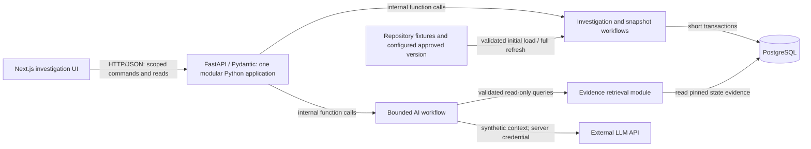

# OpsPilot AI — System Architecture v0.1

**Status:** The [Decision Log](DECISION_LOG.md) records the approved stack and first-slice scope (D-019–D-022), plus the owner-approved Task 3 staged-initialization clarification (D-023). This document specifies the target contracts; actual implementation and verification are recorded in [Project Status](PROJECT_STATUS.md). Task 3 implements stages 001–002 and the owned workspace endpoints; the full first slice remains incomplete.
**Scope:** Application structure, technology comparisons, component responsibilities, communication/failure paths, API boundaries, and the approved first implementation slice. This is design documentation, not an implemented system.

[Domain Model](DOMAIN_MODEL_ERD_V0.1.md) owns ERDs, the 29-table target, constraints, indexes, and draft/revision persistence. [Decision Log](DECISION_LOG.md) is the approval source of truth and maps former review D1–D13 labels to canonical `D-NNN` IDs used here. [Project Status](PROJECT_STATUS.md) tracks current readiness. The approved [PRD](PRD_V0.1.md) and [UX Blueprint](UX_BLUEPRINT_V0.1.md) remain the product baseline; this split changes neither scope nor approvals.

The owner resolved the three previously open boundaries: local-first then isolated hosted visitors (D-014), bounded synchronous and retryable execution without a durable queue (D-015), and developer-configured repository fixture versions without runtime administration (D-016). Application architecture can now be compared against those constraints.

Case grouping, event identity, current-pointer details, note carry-forward, and progress wording still require logical/workflow refinement; they do **not** block drawing the initial system/container boundaries. Retention and exact index/guard mechanisms must be resolved before the relevant persistence/deployment implementation, not used as reasons to postpone all architecture discussion.

## 1. Application architecture — direction approved in D-017/D-018

The owner approved Next.js frontend plus one modular Python backend (D-017), visitor-scoped ownership (D-018), FastAPI/Pydantic (D-004), and PostgreSQL (D-005). Comparisons below preserve the reasoning; session/access tooling are now resolved in D-019–D-021; later persistence features remain open.

### 1.1 Modular monolith versus microservices

A **modular monolith** is one backend application whose code is divided by responsibility. Its modules call each other within the application and can participate in one database transaction. **Microservices** put business capabilities in independently deployed backend applications with explicit network/data-ownership boundaries. A separate frontend does not, by itself, make the backend microservices.

| Concern | Modular backend monolith | Microservices |
|---|---|---|
| Fit to this MVP | One investigation workflow; related evidence, proposals, reviews, and snapshots stay together. | No demonstrated independently scaling capability or independent team ownership. |
| Implementation/debugging | Fewer network boundaries; easier end-to-end tracing and atomic Save/refresh. Modules still need clear interfaces. | More contracts, deployment coordination, network failures, and cross-service consistency work. |
| Reliability/security | One backend failure can interrupt a request; D-015 makes that visible/retryable. Central ownership checks are easier to apply consistently. | Can isolate some service failures if designed well; also adds partial-failure and service-authentication cases. Splitting services does not automatically make the system safer. |
| Cost and learning | Fewer backend deployment units; focuses learning on APIs, transactions, evidence, and governed AI behavior. | Additional operating overhead teaches distributed systems, but would consume time without a current product need. No hosting-price claim is made. |

**Approved direction (D-017):** one modular backend, preserving atomic snapshot publication; no MVP microservices. The general trade-offs around independent deployment, distributed consistency, and operational complexity are described in the [Azure Architecture Center microservices guide](https://learn.microsoft.com/en-us/azure/architecture/guide/architecture-styles/microservices).

### 1.2 Next.js-only backend versus a separate Python backend

Both options can support this MVP. Retrieval, output validation, and read-only tool boundaries are application responsibilities rather than capabilities exclusive to Python.

| Concern | Next.js frontend and TypeScript backend | Next.js frontend and separate Python backend |
|---|---|---|
| Build/debug complexity | One language and application runtime; reuses the owner's strongest skills. Domain modules must remain separate from route/UI code. | Two runtimes and an HTTP/JSON contract; adds schema alignment, error mapping, and local/deployment configuration. |
| Deployment/cost | Fewer runtime units to operate; a plausible lower-overhead route for this small application. | Web/frontend hosting plus a backend runtime; can share a host, but still needs deliberate process/routing management. Exact cost depends on hosting and model usage. |
| Reliability | Fewer application network hops; frontend/backend releases share a lifecycle. | UI and backend can be deployed separately; introduces API connectivity/version-compatibility failures. Neither option guarantees better uptime. |
| Security | Server-only endpoints can own credentials and enforce visitor boundaries. Being in the frontend repository does not make those endpoints private. | Backend owns credentials, visitor checks, database access, and AI execution; one API surface to protect. Keeping a separate process does not itself provide authorization. |
| Learning | Strong practice in backend design using familiar TypeScript; smaller language-learning step. | Direct practice with Python APIs, validation, transactions, provider integration, and cross-language contracts, aligned with the owner's stated backend/AI learning goals. |

Next.js supports HTTP Route Handlers; its documentation also notes deployment-dependent handler timeouts. Thus a bounded synchronous workflow must fit the chosen host's request limits whichever language we use. A Python backend is not automatically free of proxy/provider timeouts. [Next.js backend guide](https://nextjs.org/docs/app/guides/backend-for-frontend).

**Approved direction (D-017):** Next.js frontend plus one modular Python backend. The additional API/runtime work supports the owner's Python/backend and FDE/AI engineering learning goals. Next.js-only remains a historical alternative. D-004–D-005 subsequently select FastAPI/Pydantic and PostgreSQL; D-020/D-021 now select SQLAlchemy/Alembic. Model provider and hosting service remain open.

### 1.3 Responsibilities and communication

These are responsibility boxes, not separate services or a prescribed source-directory structure. Only the frontend and backend are application runtime units; retrieval, orchestration, and snapshot code live inside the backend. Local calls do not need HTTP or an MCP server between modules. Browser-side UI requests and any server-rendered frontend requests use the same authorized backend API; exact same-origin routing/proxy arrangements remain deployment design.

| Boundary/module | Owns |
|---|---|
| **Frontend** | Incident/thread/case navigation, evidence display, proposal/decision distinction, individual review controls, pending/failure/retry states, and rendering server-confirmed draft/revision state. Holds no model/database credentials and makes no direct database/model calls. |
| **Backend API and visitor boundary** | Validate requests; resolve visitor identity; verify ownership on every investigation, draft, revision, citation, and export operation; enforce per-operation and demo-usage bounds. Do not trust a visitor ID supplied in a JSON body. D-019 anonymous visitor cookie session; see section 4. |
| **Investigation workflows and persistence** | Durable draft writes, individual human decisions, stale-write checks, full-copy Save, exact historical load, atomic D-012/D-016 refresh, and reviewed-summary export. Own transaction/immutability rules once; do not duplicate them in Next.js handlers. |
| **Evidence retrieval** | Bounded source/identifier queries against the selected state's synthetic evidence, explicit match/correlation reasons, source limitations, and request/result history. No arbitrary SQL from the model, live connectors, payment mutations, or automatic identity links. |
| **AI orchestration** | Validate scope, select bounded retrieval calls, manage prompts/deadlines/call budgets, invoke the external model through an internal adapter, validate output/reference structure, and return unreviewed proposals. Retrieved content is data, not instructions. Cannot record a human decision. |
| **Database** | Durable state and request history, structural keys/constraints, and atomic commits. Backend alone owns domain reads/writes. No separate database per internal module or visitor is proposed. |

An adapter here means a small internal boundary for the model request/response, not a generalized multi-provider platform. Similarly, snapshot persistence stays encapsulated under D-013 without adding a snapshot service. No orchestration framework, vector index, Redis cache, durable queue, microservice split, or runtime fixture administration is introduced by this design.

### 1.4 One bounded synchronous request and its failures

1. The UI sends a targeted request with the active investigation/thread/case and expected draft identity/version. The backend resolves visitor scope and verifies it before reading evidence.
2. A short transaction records request identity, start/deadline, and originating state/context. Retrieval selects records from that pinned state and persists its outcomes in short compatible draft transactions.
3. The bounded AI workflow calls the model outside database transactions. Application-level deadlines and call/output limits prevent an unbounded loop; transport timeouts must accommodate that budget. Synchronous means request-bound execution, not a ban on asynchronous I/O.
4. Before attaching generated proposals/results, recheck visitor ownership, state/draft version, and operation identity. The operation tracks version changes from its own commits; unrelated changes can make its output stale. Reject stale attachment rather than moving results to whichever thread/draft is currently open or editing a revision.
5. On timeout/failure, keep available request history and show a retryable outcome. If the process dies before writing completion, the next draft read/retry reconciles overdue unfinished work as interrupted; no durable job automatically resumes it. Frozen history remains an as-of snapshot, including any request that was pending when saved, not a live promise of running work.

First-slice request history/deadlines are finalized in §4.3 and implemented in Task 4B; later AI operation details remain deferred. See [actual verification and limits](EVIDENCE_RETRIEVAL.md). Retrying a failed evidence/AI request creates a linked request; Save/refresh publication retries retain their idempotent operation key and do not create duplicate revisions.

### 1.5 D-018 ownership relationships and next review

**Approved scope:** one investigation per **visitor context + incident**, replacing the original global incident uniqueness. The conceptual diagram now has Visitor Context → many Investigations and Incident → many Investigations; the logical model adds `visitor_contexts`, its FK on `investigations`, and UQ `(visitor_context_id, incident_id)`.

For example, visitor V1 and visitor V2 may each investigate incident I1. Two rows `(V1, I1)` and `(V2, I1)` are valid; a second `(V1, I1)` is rejected. Each investigation still has its own two threads, at most one editable draft, and numbered revision history. Read-only fixture incident identity can be shared; visitor conclusions and drafts are not.

Authorize descendant access through `evidence/citation/decision → investigation_state → investigation → visitor_context`. Compare the resolved owner with the backend-validated request context, including for late model results. State-scoped FKs prevent historical mixing but do not replace this authorization check. The ownership association is stable; context expiration/deletion must not cascade away immutable history without an agreed retention policy.

The additional owner header in the [Domain Model](DOMAIN_MODEL_ERD_V0.1.md) is a logical relational proposal implementing D-018, not an enterprise account model. D-019 subsequently selects anonymous opaque-cookie sessions stored on that header; login, JWTs, and account recovery are not introduced. A local development context uses the same ownership boundary. D-019–D-022 now resolve anonymous sessions, SQLAlchemy/Alembic, and the first-slice scope. Section 4 supplies its implementation contract.

## 2. Python framework and relational persistence comparison — approved in D-004/D-005

The existing Python/OOP study, introductory Flask APIs, and SQL foundation are sufficient starting points. The question is which additional complexity earns its place for this API-oriented, visitor-isolated demo. The original 28 relations, now 29 with the ownership header, do not by themselves require a particular framework or database. The [Domain Model](DOMAIN_MODEL_ERD_V0.1.md) owns the complete tables, keys, and persistence details.

### 2.1 FastAPI versus Flask

| Criterion | FastAPI | Flask |
|---|---|---|
| Existing learning progress | Adds Python type annotations, Pydantic schemas, and reusable request dependencies. Builds on API fundamentals and the owner's TypeScript experience. | Smaller immediate learning step because introductory Flask routing/request handling is already familiar. |
| Request/response contracts | Integrates schema validation and OpenAPI documentation; useful for explicit Next.js/Python contracts and nested evidence/proposal responses. | Keeps the core small; schema validation and API documentation require deliberate application/library integration. More flexibility, more assembly. |
| Tables, composite FKs, Save/refresh | Database access, composite-key mapping, transaction boundaries, and immutable-history rules remain separate persistence/domain responsibilities. | Same responsibility split. Flask does not become unsuitable because the model has many related tables. |
| AI calls and bounded execution | Supports regular and async handlers. Async I/O can let other work proceed while a model/network call waits, when libraries are compatible. Request deadlines and stale-result checks remain required. | Straightforward synchronous calls suit D-015. Async views are possible, but under Flask's WSGI model a request still occupies a worker; deployment capacity must account for waiting calls. |
| Visitor-isolated hosting | A reusable dependency can resolve visitor context for routes; ownership checks still belong in backend application/query boundaries. Requires a production server and configuration. | Request hooks/application services can provide the same owner checks. Also requires a production server/configuration. Neither supplies our visitor policy automatically. |
| Complexity, cost, and FDE learning | More concepts initially, but less repetitive API-schema/documentation work. Good practice with typed contracts, validation, and API integration. No measured hosting/performance advantage is asserted. | Faster familiar starting point; useful practice assembling validation/docs explicitly. No database service cost advantage over FastAPI; operating cost depends mainly on the chosen deployment and workload. |

FastAPI's validation, generated API documentation, and dependency features are documented in its [feature guide](https://fastapi.tiangolo.com/features/); regular/async handler behavior is explained in its [concurrency guide](https://fastapi.tiangolo.com/async/). Flask's small extensible core is explained in its [design guide](https://flask.palletsprojects.com/en/stable/design/), with worker behavior in its [async guide](https://flask.palletsprojects.com/en/stable/async-await/).

**Approved choice (D-004): FastAPI with Pydantic**, because explicit request/response contracts and reusable visitor-context validation are central to our frontend/backend boundary. The additional learning fits the owner's backend/AI goals. Flask remains a capable historical alternative. D-004 does not select an ORM, database, session mechanism, or agent framework. HTTP schema validation cannot prove citation correctness or authorize ownership on its own.

D-015's synchronous execution means an operation is bounded by a request rather than durably queued. It is compatible with async network I/O; we need not convert every database/helper function to async. Choose a consistent driver/execution approach during implementation design. Neither framework's in-process tasks would satisfy durable execution, which is excluded for this initial MVP anyway.

### 2.2 PostgreSQL versus SQLite

| Criterion | PostgreSQL | SQLite |
|---|---|---|
| Relational model/composite FKs | Supports composite keys, FKs, and constraints suited to the state-scoped schema. | Also supports composite keys/FKs. Enable and verify FK enforcement on every connection. Table count is not a disqualifier. |
| Atomic Save/full refresh | One transaction can publish copied rows, revision metadata, and draft baseline changes. Application-chosen locking can serialize writes for the same investigation. | Also supports atomic multi-table transactions. One write transaction at a time per database file means snapshot copies serialize with other visitors' writes. Keep writes short and handle contention. |
| Hosted isolated visitors | Shared client/server database supports concurrent application connections and row-level conflict control. D-018 still needs backend ownership checks. | A low-traffic, single-instance hosted backend can work well with a durable local database file. Visitor ownership checks are equally necessary. Multi-instance file placement/coordination makes deployment less straightforward. |
| Development/hosting | Adds a database service, credentials, connections, durable storage, backups, and administration or managed-service costs. No provider or price is selected. | Simplest local setup; no separate database server. Hosted durability still needs persistent storage, backup, and operational care; file access is a security boundary. An ephemeral app filesystem does not meet D-009. |
| FDE/backend learning | Builds on SQL with transactions, concurrent writes, locks, connection handling, and server database operations relevant to customer-facing integrations. | Strong learning for relational modelling and transactions with less operations overhead; less exposure to a separately operated database service. |
| Reasons to prefer it here | Hosted visitors can independently save full snapshots while others persist drafts/history. Provides a direct route to that operating model and the stated learning goals. | Excellent alternative if the demo stays single-instance with low write contention and minimal setup is the overriding priority. No claim that the current tiny dataset exceeds its capacity. |

Composite FKs are supported by both engines: [PostgreSQL constraints](https://www.postgresql.org/docs/current/ddl-constraints.html), [SQLite foreign keys](https://www.sqlite.org/foreignkeys.html). Their relevant write/concurrency behavior is documented in [PostgreSQL row-level locking](https://www.postgresql.org/docs/current/explicit-locking.html), [SQLite transactions](https://www.sqlite.org/lang_transaction.html), and [SQLite deployment guidance](https://www.sqlite.org/whentouse.html). These are capabilities and operating constraints, not performance measurements for OpsPilot.

**Approved choice (D-005): PostgreSQL**, primarily for the hosted concurrent-visitor direction, per-investigation write coordination, and server-database learning value. The trade-off is additional local/deployment administration. SQLite remains a capable historical alternative; choosing PostgreSQL does not imply SQLite lacks relational integrity or cannot host visitors.

D-005 explicitly uses PostgreSQL locally and in the hosted demo so key, transaction, and locking behavior are exercised consistently. PostgreSQL does not imply pgvector, Redis, a managed hosting provider, an ORM, or a durable queue. It does not automatically implement historical immutability, safe human review, or visitor authorization.

The owner approved these choices as D-004–D-005. Their scope did not approve ORM/migrations or sessions; D-019–D-021 subsequently resolve those. Hosting/model provider, vector storage, and orchestration framework remain open. No application code, migrations, or installations were performed.

### 2.3 Other persistence operating models considered

PostgreSQL is selected (D-005), not a pending candidate. Its separate service can provide a data-access boundary, but correct access controls, transaction isolation, and frozen-state guards still require design. SQLite's local-file and server deployment trade-offs are incorporated in the comparison above; the [official deployment guidance](https://www.sqlite.org/whentouse.html) provides additional context. Neither operating model alone establishes production readiness.

The following nonselected alternatives retain earlier reasoning. Snapshot-copy, immutable-sharing, serialized-snapshot, and replay alternatives remain in the [Domain Model](DOMAIN_MODEL_ERD_V0.1.md), where their persistence implications belong.

| Alternative | Cost and operational complexity | Reliability/security considerations | Learning value and decision trigger |
|---|---|---|---|
| **Document-oriented storage for whole states** | Natural aggregate representation; less direct mapping from the proposed relational tables and likely more application validation. | Exact snapshots are possible, but cross-document association/citation integrity and multi-record publication guarantees need product-specific verification. | Could fit a deliberate aggregate-first design. Currently offers less direct practice of the relational constraints requested for this project. |
| **Plain fixture/JSON files for all mutable persistence** | Minimal initial setup; reliable atomic replacement, writer coordination, and backup become application work. | Harder to enforce related-row integrity and atomic multi-part saves. Memory-only or ephemeral files fail D-009. | Keep files as approved synthetic input; they are not the proposed system of record for durable drafts and numbered relational history. |

SQLAlchemy 2.x and Alembic are now approved in D-020/D-021. Database/package patch versions, hosted service, vector extension, Redis, and object storage are not selected by those approvals. No prices or OpsPilot performance measurements are asserted.

## 3. Components and approved first end-to-end implementation slice

**Status:** Journey and 17-table subset approved in D-022. The contracts below finalize the handoff; they do not authorize application code in this design chat. This is a partial MVP increment, not the complete PRD/UX experience.

### 3.1 High-level components

| Component | Responsibility | First slice |
|---|---|---|
| **Next.js workspace** | Incident entry, shared header, thread navigation, case list, and source-grouped expandable evidence. A small API client maps validated responses and visible loading/error states. | Implement this journey; preserve selected thread/case. Findings and assistant capability are clearly unavailable in this increment, with no fabricated content. |
| **FastAPI boundary / visitor access** | Pydantic request/response schemas, visitor resolution, ownership checks, consistent errors. Calls application services; no domain logic duplicated in Next.js. | Required for all investigation endpoints. Visitor IDs in request bodies are not trusted identity. |
| **Investigation service** | Start/resume a visitor's incident investigation; initialize exactly two threads and one durable draft; later own Save/refresh/review workflows. | Atomic create-or-return-existing investigation and draft load only. No revision creation. |
| **Dataset loader** | Validate the configured repository version, manifest/digests, explicit case definitions/memberships, source records, links, and declared gaps. | Initial load only. Cases are application investigation groupings with source references, not invented payment facts or heuristic customer matches. |
| **Evidence query service** | List cases and retrieve bounded same-state evidence with correlation basis/source limits; record evidence request/outcome history. | Four source sections with record details, case association explanations, supported cross-record links, and distinct no-match/not-included/error states. |
| **Persistence / transactions** | PostgreSQL access, scoped keys, ownership-aware queries, transaction boundaries, and mapping source content to API schemas. | Implement only the slice subset below. SQLAlchemy 2.x and Alembic are approved; use the transaction/migration contract in section 4. |
| **Later: AI, claim review, snapshots/export** | Bounded model orchestration; separate proposals/human decisions; full-copy Save/atomic refresh; exact history/export. | Keep these responsibilities in the architecture; no routes, model calls, review actions, revision/history behavior, or empty feature implementations in this slice. |

These are internal responsibilities in one backend, not separate services or a prescribed folder hierarchy. PostgreSQL and model credentials remain backend-only; the first slice needs no model credential or external model call.

### 3.2 First-slice journey and transaction

**Known incident → create/resume owned investigation → choose thread → list cases → inspect evidence → reload the same owned draft.**

Validate/prepare the configured fixture content before database publication. **D-023 permits the Task 3 staged workspace:** one transaction creates the visitor/incident association, pinned state, durable draft, exactly two thread states, and all nine source-coverage rows, using only migration stages 001–002. Workspace case counts are derived from the pinned validated fixture manifest and displayed as configured cases, not persisted case rows or reviewed outcomes. Case/evidence relational persistence is deferred to stage 003, and evidence-request history/execution to stage 004. Later materialization must be atomic and keep the same owned state and pinned dataset; it must not silently refresh an existing investigation. Nothing is exposed as initialized if the Task 3 transaction fails. Catalog/visitor headers committed earlier remain outside that rollback boundary. Reopening returns the existing owned workspace; the unique visitor/incident pair prevents duplicate initialization, including competing requests.

Case selection and evidence inspection do not create numbered revisions. All progress is **Not started** because no findings or human reviews exist yet. Display source-supported payment states separately; never infer a bank charge from an attempt or timeout. Typed financial aggregates/analysis and Overview metrics are deferred. Render the supplied attempt/event fields from Evidence Records without needing the later typed-observation tables.

### 3.3 First-slice HTTP boundaries

All paths use `/api/v1`. All endpoints except session bootstrap require a valid D-019 cookie. The exact field contracts and errors are in section 4.

| Method and path | Request | Successful response |
|---|---|---|
| `POST /visitor-session` | Empty JSON object; existing valid cookie is reused. | 201 new / 200 existing; `VisitorSession`. Only creation sets the secret cookie after commit. |
| `GET /incidents/{incident_ref}` | Known fixture reference, e.g. `INC-2026-1042`. | 200 `IncidentEntry` from the configured approved fixture catalog. |
| `POST /investigations` | `InvestigationCreate` with `incident_id` only. | 201 new / 200 existing; `Workspace`. Existing owned drafts are returned without refresh. |
| `GET /investigations/{investigation_id}/workspace` | UUID path ID. | 200 `Workspace`; restores the owned persisted draft. |
| `GET /investigations/{investigation_id}/threads/{thread_kind}/cases` | UUID investigation, thread enum, required `state_id` query UUID. | 200 `CaseList`; all cases in that thread, no pagination. |
| `POST /investigations/{investigation_id}/threads/{thread_kind}/cases/{case_id}/evidence-requests` | `EvidenceRequestCreate` with state/version and optional retry reference. | 200 `CaseEvidence` for completed/partly successful retrieval; source outcomes are explicit. |

**Contract refinement:** this replaces the earlier proposed `GET .../evidence` with an explicit evidence-request creation POST. The operation records query history, can be retried intentionally, and receives the same origin/CSRF protections as other POSTs. It adds no product capability or table. Workspace/case GETs are read views, not evidence queries; inline record expansion is local to the complete case response and makes no additional query.

### 3.4 Minimum subset of the agreed relational model

**17 approved domain tables for this first slice**, rather than all 29. Session credentials are columns on `visitor_contexts`, not an eighteenth product table. Their dependency groups are:

| Purpose | Tables |
|---|---|
| Ownership and fixture identity (4) | `visitor_contexts`, `incidents`, `dataset_versions`, `investigations` |
| Durable workspace and source coverage (4) | `investigation_states`, `working_drafts`, `thread_states`, `state_sources` |
| Cases and inspectable evidence (5) | `payment_cases`, `case_threads`, `evidence_records`, `case_evidence_links`, `evidence_relationships` |
| Evidence path history under FR-11 / D-015 (4) | `evidence_requests`, `request_sources`, `retrieval_results`, `retrieval_result_records` |

**Staged schema dependency:** the target `working_drafts.base_revision_no` FK references the later `investigation_revisions` table. Omit that baseline column/FK in this initial schema and introduce it with revision history. Do not create revision zero or an empty history feature merely to satisfy the future FK. Other first-slice tables reference only this subset. The full 29-table inventory remains the target proposal in the [Domain Model](DOMAIN_MODEL_ERD_V0.1.md).

Defer the remaining 12 tables: typed payment observations/matches (`payment_attempts`, `case_attempt_links`, `payment_lifecycle_events`, `attempt_event_links`), findings/review/basis (`findings`, `finding_cases`, `ai_proposals`, `human_review_decisions`, `evidence_citations`, `assessment_result_refs`), `annotations`, and `investigation_revisions`. Source records still preserve payment lifecycle distinctions; specialized tools/aggregates can add typed projections later.

### 3.5 Completion evidence and implementation-chat handoff

The slice is complete only when an actual browser/API journey demonstrates: reopening the same visitor/incident draft without duplication; two stable threads and correct case memberships; independent investigations for two visitor contexts; rejection of cross-visitor IDs and stale state; inspectable evidence and truthful source gaps; durable evidence query history; and rollback of failed initialization. Reload/backend restart must preserve the stored workspace. These are planned acceptance checks, not tests already run.

D-019–D-022 resolve the prior design blockers. Section 4 supplies API, fixture mapping, migration, and acceptance details. Implementation setup still needs a supported PostgreSQL driver/version, a reachable local PostgreSQL instance, and local HTTPS/same-origin routing; these are setup tasks rather than reasons to reopen the architecture.

The Implementation Codex chat should read this document, [Domain Model](DOMAIN_MODEL_ERD_V0.1.md), [Decision Log](DECISION_LOG.md), [Project Status](PROJECT_STATUS.md), and the approved PRD/UX/screens, then guide the owner through small increments: schema/catalog/session → atomic investigation initialization → API evidence/history → Next.js journey → acceptance checks. The owner writes the implementation. No code or migrations are written in this design chat.

## 4. First-slice implementation contract

These are implementation details for the approved scope; D-023 further permits the staged Task 3 initialization described in §3.2. No login, recovery, AI calls, human review, annotations, numbered revisions, refresh UI, or export is included.

### 4.1 Anonymous visitor session lifecycle and security

- Use one opaque CSPRNG-generated **256-bit token** per visitor context initially. Its base64url representation is 43 characters without padding. Store only its SHA-256 digest in `visitor_contexts`; the raw token exists transiently on creation and in the browser's cookie, never in API JSON, URLs, storage accessible to JavaScript, source control, logs, or database rows. A public visitor UUID is not a credential. Enforce the cookie's 43-character base64url format before lookup; never echo a rejected value.
- Bootstrap with `POST /visitor-session`. A valid cookie resolves the existing context and returns 200 without replacing or extending it. Otherwise create a new context/token and return 201. Serialize initial bootstrap in the frontend to avoid racing independent anonymous contexts. Never create a database credential from an arbitrary client-supplied token.
- Cookie name: `__Host-opspilot_visitor`; attributes: **Secure, HttpOnly, SameSite=Lax, Path=/**; no Domain attribute. Set Max-Age/Expires to the remaining server lifetime. First-slice policy default: **24-hour absolute expiry**, configured server-side as `VISITOR_SESSION_TTL_SECONDS`, with no sliding renewal. Changing configuration does not extend existing rows. This duration is an application default, not an OWASP requirement.
- Hash the received cookie and look up the unique digest on every protected request. Reject missing/malformed/unknown/expired/invalidated credentials. Check server expiry, not only cookie expiry, and recheck before a multi-step operation returns protected data or commits its result. Never accept owner IDs from bodies/headers/query parameters as proof of access.
- Missing/invalid/expired cookies produce 401 on protected endpoints; do not silently replace the visitor or attach old work to a new context. The UI offers a fresh demo through bootstrap. Clear invalid/expired cookies. Browsers can omit expired cookies, so expiry may appear as a missing-cookie response. Expiry invalidates access, not ownership or stored data: retain rows and do not cascade-delete investigations. Lost/expired tokens have **no recovery**; the same visitor UUID cannot restore access. No login/logout/recovery screens or session-rotation feature are required in this slice.
- Use a **single configured HTTPS browser origin locally and hosted**, routing `/api/v1` to FastAPI. Preserve Cookie/Set-Cookie and the original Origin across the thin routing layer. Local development must test the Secure cookie over HTTPS; do not weaken the approved flags for convenience. Exact certificate/proxy setup is implementation configuration, not a new service choice. Next.js [rewrites](https://nextjs.org/docs/app/api-reference/config/next-config-js/rewrites) can provide API forwarding; cookie behavior must be verified end to end.
- For every POST, including bootstrap and evidence requests, require `Content-Type: application/json`, `X-OpsPilot-Request: 1`, and an Origin exactly matching configured `PUBLIC_ORIGIN`. Reject missing, null, or mismatched Origin; do not derive trust from arbitrary forwarded headers. No cross-origin credentialed CORS allowlist is needed for this same-origin slice. SameSite is defense in depth, not the only CSRF control.
- Set `Cache-Control: no-store` on API responses. Next.js must not share/cache owned responses between visitors; server-rendered API reads forward the request's cookie. Redact Cookie/Set-Cookie and token digests from diagnostics and disable SQL parameter logging for credentials. Render fixture content as escaped text rather than executable markup. HttpOnly does not prevent malicious scripts from issuing same-origin requests.

The token/cookie security properties are grounded in [OWASP session guidance](https://cheatsheetseries.owasp.org/cheatsheets/Session_Management_Cheat_Sheet.html); the exact-origin/custom-header protection follows [OWASP CSRF guidance](https://cheatsheetseries.owasp.org/cheatsheets/Cross-Site_Request_Forgery_Prevention_Cheat_Sheet.html). The 24-hour policy and single-credential/context layout are deliberate minimal implementation defaults.

### 4.2 API schemas and validation

Use explicit Pydantic input/output models, not automatic serialization of ORM objects. Input objects reject undeclared fields. Header IDs (`visitor_context_id`, `incident_id`, `investigation_id`, `state_id`, `dataset_version_id`) and request UUIDs are application-generated UUIDs; state-local case/record/relationship IDs are stable fixture keys of 1–128 characters using letters, digits, dot, underscore, colon, or hyphen. Credentials have their separate strict token format. Thread values are exactly `payment_failures` and `possible_duplicates`; draft versions are nonnegative integers.

| Schema | Required shape and meaning |
|---|---|
| `VisitorSession` | `visitor_context_id: UUID`, `expires_at: UTC timestamp`. No token/hash. |
| `InvestigationCreate` | `incident_id: UUID`. Owner, dataset version, fixture path, state, and thread overrides are forbidden. |
| `EvidenceRequestCreate` | `state_id: UUID`, `expected_draft_version: nonnegative integer`, optional `retry_of_request_id: UUID or null`. No SQL, arbitrary filters, source URLs, or evidence IDs supplied by the caller. |
| `DatasetVersion` | `dataset_version_id: UUID`, `version_label: string`, `fixture_digest: SHA-256 hex string`. Describes the pinned content, not a client-controlled version selection. |
| `SourceTime` | `role: string`, `raw: string or null`, `timezone: string or null`, `precision: second/minute/minute_range/unknown/not_applicable`, `utc_lower/utc_upper: UTC timestamp or null`, `missing_reason: string or null`. Normalized bounds are derived only when source precision/zone allow it, and are never presented as invented exact event seconds. Preserve original text; unknown zone/time remains null with a reason. |
| `Money` | `amount: decimal string`, `currency: source currency string`; the whole object is null when absent. Never use a JSON float or sum attempt/capture values into a reported amount. |
| `IncidentContext` | `incident_id`, `incident_ref`, source-backed `title`, nullable description/category/severity/region, `synthetic: true`, source incident time as `SourceTime`, and source fixture alert reference. No operational decisions generated by OpsPilot. |
| `IncidentEntry` | `incident: IncidentContext`, `dataset_version: DatasetVersion`. Reads the current configured catalog; after investigation creation use its pinned workspace context instead. |
| `Workspace` | `investigation_id`, `state_id`, `draft_version`, `dataset_version`, pinned-at-initialization `incident: IncidentContext`, and exactly two `threads` entries `{thread_kind, label: string, case_count: nonnegative integer}`. No revision number or AI/review result fields. |
| `CaseSummary` | `case_id: LocalID`, `case_reference: string`, `primary_report_record_id: LocalID`, nullable string `customer_ref`/`reported_order_ref`, `related_order_refs: RelatedOrderReference[]`, `reported_issue: string`, `reported_money: Money or null`, `reported_at: SourceTime`, `payment_state: PaymentState or null`, `investigation_progress: not_started`. Reported and lookup-derived values stay distinct. |
| `CaseList` | `investigation_id`, `state_id`, `draft_version`, `thread_kind`, `cases: CaseSummary[]`. No pagination or hidden cross-thread search in this fixture-sized slice. |
| `EvidenceRecord` | `evidence_record_id: LocalID`, `source_key: SourceKey`, original `source_name: string`, `record_type: string`, `source_record_reference: string or null`, `synthetic: true`, `fixture_provenance: {version_label, fixture_record_id, origin}`, `timestamps: SourceTime[]`, retained `payload: JSON object`, and `case_association: AssociationBasis`. No persistence/session internals. One provider extract may contain several observations; never split it into fabricated source events. |
| `EvidenceRelationship` | Local IDs `relationship_id`/`from_record_id`/`to_record_id`, `basis: AssociationBasis`, `attribution: string`, `limitations: string[]`. All endpoints/bases exist in this state; returned links target records in the case response. |
| `SourceOutcome` | `source_key: SourceKey`, `source_name: string`, `execution_status: completed/failed/interrupted` in a final response, `availability: included/not_included/not_constructed/unavailable`, `match_status: matches/no_matches/not_evaluated`, `returned_count: nonnegative integer or null`, `records: EvidenceRecord[]`, `scope: string or null`, `completeness: unverified/known_partial/verified_for_stated_scope/not_applicable`, `limitations: string[]`, `error_code: string or null`. Count is 0 only for evaluated zero matches; failed/not-evaluated counts are null. Coverage remains distinct from execution. |
| `CaseEvidence` | Transport `request_id`, persisted `evidence_request_id`, investigation/state IDs, committed `draft_version`, thread/case IDs, top-level `status: completed or partial`, four `groups: {group_kind, sources: SourceOutcome[]}[]`, and `relationships: EvidenceRelationship[]`. Each record is returned once under its actual source. |

Here `LocalID` is the bounded fixture-key string above, and `SourceKey` is one of the nine manifest keys in section 4.4. Four group kinds are exactly `internal_payments`, `provider`, `logs_traces`, `support_tickets`. Empty lists are represented as `[]`, not omitted.

- `RelatedOrderReference`: `{value: string, association: direct/candidate/contextual, basis_record_id: LocalID}`.
- `PaymentState`: `{label: string, basis_record_ids: LocalID[], limitations: string[]}`; this is source-backed display context, not a reviewed claim or case-level charge verdict.
- `AssociationBasis`: `{category: direct_ref_match/documented_lookup/field_match/temporal_context/unverified, matched_fields: JSON object, explanation: string, basis_record_id: LocalID or null}`. `matched_fields` preserves actual field names/values. No unexplained confidence score.
- `fixture_provenance` fields are nonempty strings except `fixture_record_id`, which is a LocalID. `origin` identifies constructed synthetic material, never a real system retrieval. `record_type` is the manifest-defined source kind (alert, metric series, ticket, lookup, escalation, attempt, provider extract, log, trace, or deployment timeline), not an AI-generated classification.

All successful responses also carry `X-Request-ID`; error bodies carry the same transport UUID. This transport correlation ID is distinct from the persisted evidence-request UUID. System timestamps use ISO 8601 UTC; source time objects preserve their own precision and zone. Nullable fields use JSON null plus an appropriate reason/provenance, not invented IDs, zero amounts, or guessed outcomes.

Case/evidence calls validate the requested state against the owned current draft. `GET .../cases` requires `state_id`; the evidence POST also checks the expected draft version. The UI updates its version from responses and reloads Workspace after a version conflict. Thread/case membership and every record's state scope are checked server-side; knowing a UUID never grants access. All POST bodies are small, capped at 4 KiB; responses are bounded by the validated, complete small fixture manifest, never silently truncated. Inline expansion operates on the returned payload.

### 4.3 Errors, execution, and evidence history

Error envelope: `error: {code, message, request_id, retryable, details}`. `details` is an allowlisted object containing safe field paths/reasons, and optionally the owned `state_id`, committed `draft_version`, or `evidence_request_id`; it excludes raw validation input, cookies/hashes, SQL, traces, and connection details. FastAPI validation failures must be normalized into this envelope.

| HTTP | Stable codes / convention |
|---|---|
| 401 | `SESSION_REQUIRED`, `SESSION_INVALID`, `SESSION_EXPIRED`; clear invalid/expired cookie and require explicit fresh bootstrap. |
| 403 | `REQUEST_ORIGIN_FORBIDDEN` for invalid Origin or required same-origin request header. |
| 404 | `NOT_FOUND` for unknown/unowned investigation, unknown case, or case absent from the selected thread; same safe response for foreign and nonexistent resources. |
| 409 | `STALE_STATE`, `STALE_DRAFT_VERSION`, `OPERATION_IN_PROGRESS`, `INVALID_RETRY_REFERENCE`; do not retarget/replay into a different draft. |
| 413 / 415 | `PAYLOAD_TOO_LARGE` / `UNSUPPORTED_MEDIA_TYPE`. |
| 422 | `VALIDATION_ERROR` for malformed JSON, invalid UUID/enum/key, missing/extra fields, or invalid values. |
| 503 | `DATASET_UNAVAILABLE`, `DATABASE_UNAVAILABLE`, `INITIALIZATION_FAILED`, `EVIDENCE_RETRIEVAL_FAILED`; bounded safe detail and visible retry where applicable. No empty-success fallback. |
| 500 | `INTERNAL_ERROR`; safe public message and correlation ID, with protected server diagnostics. |

Validate the session before owned-resource lookup. A nonexistent but syntactically valid incident returns 404; missing/corrupt configured fixtures return 503 and never fall back to another version. A successful query with no records is 200, not 404. A terminal response never labels pending sources as successfully completed; deadline-abandoned sources are interrupted/not-evaluated with null counts. Some failed sources with other completed sources produce 200 `partial` with explicit per-source failures; all requested sources failing produces 503. Known source absence/coverage limits are not retrieval failures.

Evidence request sequence:

1. Under a short per-investigation write transaction, verify session/owner, state, and membership. Reconcile overdue unfinished work first; commit that reconciliation independently, advancing the draft version when it changes history. Then compare the client's expected version and reject a stale version or any still-running operation without creating another request. Create one request plus six `request_sources`/pending result entries and a deadline, advance draft version once, and commit the start. First-slice retrieval deadline defaults to 10 seconds server-side; no job queue or automatic resumption. Bound database connection/query/lock waits by the remaining budget, and set the outer HTTP/proxy timeout to accommodate it; a deadline field alone cannot stop blocked I/O.
2. Read only the selected state's fixture records via `case_evidence_links`; each source outcome is evaluated against its declared manifest scope. A failed source read must roll back its failed database transaction before another read can proceed. Collect results without a transaction spanning network/model waits; no external calls occur in this slice.
3. In a short final transaction, recheck session/owner/current state and the version after this operation's own start; persist all source outcomes and exactly the returned record memberships, set terminal request state/time, advance draft version, and commit before returning evidence. Serialize mutation checks by the investigation row; do not use a process-local lock as the only concurrency guard.
4. If other work makes results stale, attach no evidence. If the original state is still the owned editable draft, record only terminal stale history, making pending sources interrupted/not-evaluated with null counts, without overwriting user content; never update a replaced/frozen state. If persistence fails, return 503 rather than return unrecorded evidence. A committed start can remain pending after a crash; the next current-draft read reconciles it as interrupted only after its deadline. Historical snapshots remain as-of snapshots.
5. A manual retry creates a new evidence request and can reference a prior terminal failed/partial/interrupted request with the same owned state/thread/case. It never duplicates evidence records, changes the old result, or restarts work automatically. Successful reinspection without a retry reference is also a new query. Session/validation/ownership failures and plain UI expansion create no evidence request rows.

Only one evidence operation may be pending for an investigation initially. This is a bounded execution rule, not a queue; independent visitors' investigations can progress concurrently. Workspace/case GETs normally do not change draft version, except the documented reconciliation of overdue work. Frozen snapshots and model execution remain later capabilities.

### 4.4 Fixture-to-case mapping — existing evidence only

Use [Synthetic Evidence Package](SYNTHETIC_EVIDENCE_PACKAGE.md) as the content authority. Initial application version label: `synthetic-payments-v0.1`, a developer-assigned fixture label, not a new source fact. The implementation translates existing records into a versioned machine-readable fixture/manifest; no such files are created in this chat. Configure `CURRENT_DATASET_VERSION` explicitly. On startup, validate/pin its manifest/digest and register catalog identities idempotently; the same label with different content is a readiness failure, not an overwrite.

The bundle contains **14 source records**. Split the supplied two-attempt table into its two already-named record identities; keep each Stripe extract as one record with its supplied observations. The incident is `INC-2026-1042`. App-only case IDs/references below label groupings and are explicitly not company/source records.

| Application case / membership | Primary report and reported values | Linked case evidence |
|---|---|---|
| `case-failure-001` / `CASE-FAIL-001`; `payment_failures` | `SYN-ZD-TICKET-001`; `SYN-CUST-001`, reported order `SYN-ORD-001`, SGD 48.00. | Ticket plus `SYN-PO-ATT-001`, `SYN-STRIPE-FAIL-001`, `SYN-LOKI-FAIL-001`, `SYN-TEMPO-FAIL-001` — 5 records. |
| `case-duplicate-001` / `CASE-DUP-001`; `possible_duplicates` | `SYN-ZD-TICKET-002`; `SYN-CUST-002`, SGD 120.00; reported order remains null because the ticket supplies none. | Ticket plus `SYN-ZD-HANDOFF-001`, `SYN-ZD-ESCALATION-001`, `SYN-PO-ATT-002-A`, `SYN-PO-ATT-002-B`, `SYN-STRIPE-DUP-001` — 6 records. |

The remaining three records are incident context: `SYN-PD-ALERT-001`, `SYN-GRAF-METRIC-001`, `SYN-DEPLOYMENT-TIMELINE-001`. Retain them in the state but do not force them into a case merely to fill a source section. Overview aggregate metrics remain deferred. The scenario prose's three duplicate complaints and approximately fifteen complaints do not create extra tickets/cases.

| State source key | Existing records |
|---|---|
| `incident_alert` | `SYN-PD-ALERT-001` |
| `metrics` | `SYN-GRAF-METRIC-001` |
| `deployment_history` | `SYN-DEPLOYMENT-TIMELINE-001` |
| `internal_payments` | `SYN-PO-ATT-001`, `SYN-PO-ATT-002-A`, `SYN-PO-ATT-002-B` |
| `stripe` | `SYN-STRIPE-FAIL-001`, `SYN-STRIPE-DUP-001` |
| `zendesk` | Both `SYN-ZD-TICKET-001` and `SYN-ZD-TICKET-002`, plus `SYN-ZD-ESCALATION-001` |
| `support_lookup` | `SYN-ZD-HANDOFF-001`; retain its original authorized lookup-history attribution, not a newly executed OpsPilot query |
| `loki` | `SYN-LOKI-FAIL-001` |
| `tempo` | `SYN-TEMPO-FAIL-001` |

Every case evidence request targets six source keys grouped into four stable sections: Internal Payment Records (`internal_payments`); Stripe / Payment Provider (`stripe`); Logs & Traces (`loki`, `tempo`); Support Tickets (`zendesk`, `support_lookup`). All six are represented in this fixture even when a particular case has zero matches. Expected successful section record counts are **1/1/2/1** for the failure case and **2/1/0/3** for the duplicate case. Empty Logs & Traces for the duplicate case means no matching records in this dataset, not that no technical event occurred.

Mapping/link rules:

- Use the explicit fixture case map and record IDs; do not match or merge cases by email, amount, or time. The schema permits shared case membership, but this initial fixture assigns one case to each thread; sharing does not become shared review state.
- Failure-path links cite ticket customer/order fields, attempt provider/request IDs, and log/trace correlation IDs. The ticket-to-attempt compound field match is labelled with its actual basis, not an invented transaction ID from the customer.
- Duplicate-path candidate order/attempts come from `SYN-ZD-HANDOFF-001`. Preserve `SYN-ORD-002` as a **lookup-derived candidate** with that basis, not a supplied ticket order or definitive financial match. Link the handoff/escalation via their related-ticket references; link provider extract/attempts using its explicit related attempt/request references. Idempotency-key reuse is a field correlation, not proof of deduplication or duplicate charges.
- Preserve provider completeness as unverified and bank/settlement evidence as not constructed. Do not generate refund, authorization-time, extra capture, bank debit, configuration-change, deployment-success, or root-cause records. A timeout does not establish provider failure; attempt success does not establish bank posting. Preserve all supplied source time precision/zone and keep missing source ingestion times missing.
- Preserve shared-record links with explicit field provenance, categories, and basis records. Returned cross-links stay inside the selected case's returned record set. Alert/metric time-window or deployment timing associations remain contextual, not causal or definitive payment identity links.
- Loader validation requires all manifest record IDs once, unique case keys, exactly two threads, declared memberships, valid source/relationship/basis IDs, and source payload/digest agreement. Invalid mapping or incomplete loading aborts initialization. Missing evidence declared in the manifest is valid content; a missing expected record is a load failure. Never silently omit it or substitute a different version.

### 4.5 Initial Alembic boundaries and transaction ownership

Use four ordered schema revisions. Labels below identify dependency boundaries, not generated filenames or Alembic revision identifiers; no migrations are created here:

| Stage | Tables / dependency order |
|---|---|
| 001 — ownership/catalog | `visitor_contexts`, `dataset_versions`, `incidents`, then `investigations` with owner/incident FKs and pair uniqueness. |
| 002 — working workspace | `investigation_states`, then `working_drafts`, `thread_states`, `state_sources`; retain `(state_id, investigation_id)` header consistency. |
| 003 — case/evidence graph | `evidence_records`, then `payment_cases` (primary report FK), `case_threads`, `case_evidence_links`, `evidence_relationships`, including same-state/basis references. |
| 004 — evidence path history | `evidence_requests`, `request_sources`, `retrieval_results`, `retrieval_result_records`, including retry self-FK and state/source compound references. |

Alembic schema revisions are developer-controlled schema history, not the numbered investigation revisions deferred from this slice. The 17 product tables are unchanged. Alembic's own `alembic_version` bookkeeping table is tool metadata, not an eighteenth domain table. Do not add revision-history/AI/review tables. Defer `working_drafts.base_revision_no` and its FK until `investigation_revisions` is introduced; no revision zero or empty history implementation.

SQLAlchemy 2.x uses synchronous database work initially with explicit service-owned transactions and scoped Session objects, never a global Session shared by visitors. Its database Session is not the browser visitor session. Repositories may flush but do not independently commit; initialization commits the entire new investigation/state graph once. Catalog/session rows committed earlier are outside that rollback boundary. Concurrent create-or-return is resolved by `(visitor_context_id, incident_id)` uniqueness: roll back a losing insert transaction, then read the fully committed winner in a fresh transaction. Do not return an incompletely initialized winner.

Declare each compound FK as one SQLAlchemy `ForeignKeyConstraint`, not unrelated single-column FKs. Name constraints/indexes consistently. Review Alembic candidates for keys, checks, dependency order, and reversibility; autogeneration is not a proof of completeness. Fixture registration/import is a separate validated application data operation, not migration payloads. Startup must not run `create_all`, generate/apply migrations, reset data, or rewrite prior fixture versions. Check schema readiness and run explicit Alembic upgrades in implementation/deployment setup. Destructive downgrades against stored work require explicit impact review/approval.

See [SQLAlchemy compound constraints](https://docs.sqlalchemy.org/en/20/core/constraints.html), [transaction management](https://docs.sqlalchemy.org/en/20/orm/session_transaction.html), and [Alembic autogeneration limits](https://alembic.sqlalchemy.org/en/latest/autogenerate.html). Select a compatible supported PostgreSQL DBAPI driver and exact versions during setup; that routine compatibility task does not add a service or reopen the approved persistence stack.

Task 4A implements stage 003. New investigations now publish the case/evidence graph inside
the original initialization transaction. Existing stage-002 drafts are materialized on their
first owned workspace/resume/case access, under an investigation-row lock, using their own
pinned dataset. This retains the owner, investigation, state, draft, and coverage rows. The
one committed backfill advances `draft_version` once; retries do not. New initialization
still begins at version 0. Case counts now come from persisted thread memberships. Schema
upgrade itself imports no evidence. See [Task 4A verification](CASE_PERSISTENCE.md).

Task 4B adds stage 004 and the approved bounded case evidence-request POST. Request start and
finalization commit separately; source-specific outcomes, returned-record memberships, retries,
and overdue interruption recovery are persisted under ownership/current-state/version checks.
The schema now contains all 17 first-slice domain tables. The inspection UI and automated/API
verification are complete; visual browser verification remains pending because computer-use
permissions were unavailable. See [Task 4B verification and limits](EVIDENCE_RETRIEVAL.md).

### 4.6 First-slice acceptance checklist

These checks are to be implemented/run in the Implementation Codex chat; none has passed merely because this contract exists.

- [ ] **Session security:** cookie flags/path/no Domain are verified over HTTPS; only a digest is stored; no credential appears in API JSON/logs. Origin/custom-header/media validation works. Expired/invalid credentials return 401 and cannot recover or adopt old investigations by ID.
- [ ] **Visitor isolation:** two real visitor contexts can independently investigate the same incident; each has one investigation/draft with separate state. Foreign investigation/case/state IDs cannot reveal data or write history; unknown and foreign resources return the same 404 convention.
- [ ] **Initialization and concurrency:** repeated/competing create calls return the same fully initialized owned investigation, exactly two threads, and the documented cases/memberships. One request creates it; subsequent successful reads do not refresh it or create revisions.
- [ ] **Durable reload:** within session lifetime, browser reload and backend restart retain the same visitor/investigation/state, both threads, source content, and query history; no process-memory ownership/session store is required.
- [ ] **Evidence fidelity/limitations:** 14 exact source records, 2 app cases, source counts 1/1/2/1 and 2/1/0/3, inspectable payload/time/provenance, truthful lookup-derived candidate order, unverified provider completeness, and no invented bank/extra-complaint/charge conclusions. All four source sections remain visible.
- [ ] **Query-history accuracy:** each explicit evidence POST records six source requests/outcomes; membership exactly matches the returned 5 or 6 record IDs. Reinspection/retry creates history without copying evidence. Inline expansion and rejected authentication/validation calls do not fabricate queries; historical Support lookup stays source evidence.
- [ ] **Failure/stale handling:** zero matches, known absent evidence, a failed source, all-source failure, stale state/version, expired session, and overdue interrupted request are distinct. Failed source counts are null, partial responses expose limitations, and stale results cannot attach to another state. No automatic durable resumption or hidden model call occurs.
- [ ] **Failed initialization rollback:** inject failure after part of the new graph is inserted or use an invalid/missing manifest reference; no new investigation/state/thread/case/evidence/link/history fragments survive. Earlier catalog and visitor-session rows remain valid. Fixing input and retrying creates one complete investigation without resetting other visitors.
- [ ] **Migration integrity:** explicit upgrade of an empty PostgreSQL database creates only the 17 domain tables plus Alembic metadata, in dependency order, with owner-pair uniqueness and correctly paired composite FKs; invalid cross-state/source relationships are rejected. No ORM startup schema creation or later-capability tables are present.

There is no unresolved architecture/product-data blocker for this slice. Local HTTPS routing, PostgreSQL connectivity, package/driver compatibility, and transcription of the documented fixture into machine-readable form remain implementation setup/work. Any mismatch with the frozen package must fail validation and be surfaced, never filled with fabricated evidence or a new capability.
